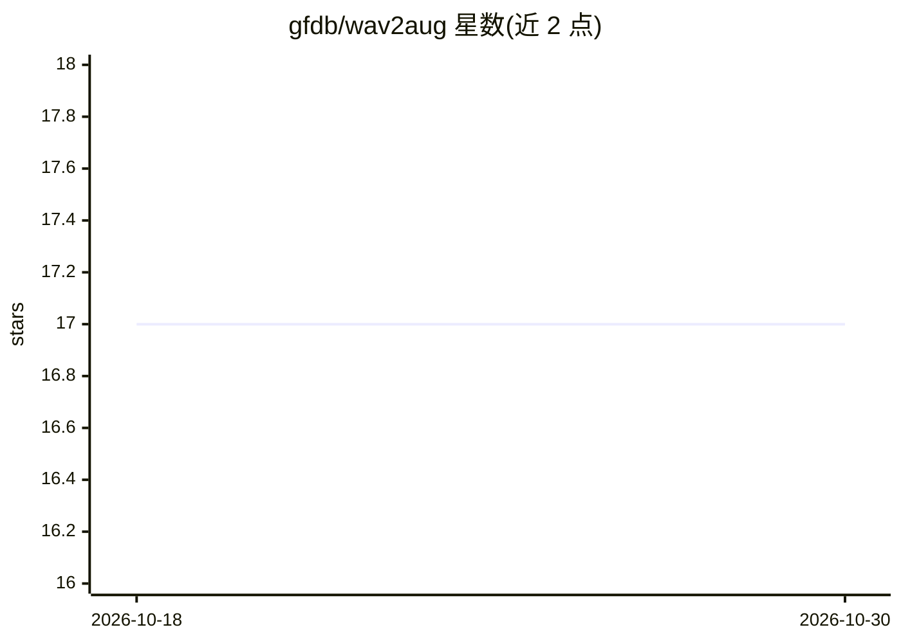

# gfdb/wav2aug

⭐ 17 · Python · Apache-2.0 · 推送 2026-03-13 · [GitHub](https://github.com/gfdb/wav2aug) · 个人维护

**任务无关的语音波形增强 PyTorch 库：免调参即装即用**

基于 PyTorch 的语音波形增强库，定位为通用、任务无关的增强策略：安装后无需调节增强超参数即可使用，每次调用随机应用两种增强。提供 GPU 与 CPU 路径（wav2aug.gpu / wav2aug.cpu），共 8 类增强操作，包括幅度缩放/削波、环境噪声叠加（含 SNR 控制）、频带丢弃、极性反转、片段交换、变速、时间丢弃与多说话人 Babble 噪声。所有随机操作使用 PyTorch RNG，设单一种子即可复现。通过 pip/uv 安装，面向语音模型训练的数据准备流程。

## 筛选速览

| 维度 | 判定 | 备注 |
|---|---|---|
| AI 角色 | `ai-ecosystem` | LLM/agent 周边工具 |
| 许可风险 | `permissive` | Apache-2.0 |
| 部署形态 | `library` | 以包/库形式分发 |
| 模型依赖 | — | README 未给出锁定关系 |
| 硬件要求 | — | 无带数字的原话,不猜 |
| 安装摩擦 | `medium` | 含编译或系统依赖之一 |
| 成熟度 | — | 结构信号不足 |

## 能力要点

- 每次调用随机应用两种增强，免调参设计
- 8 类增强操作，含 SNR 控制的噪声叠加与多说话人 Babble 噪声
- 所有随机操作走 PyTorch RNG，单一种子即可复现
- 提供 GPU 与 CPU 两种使用路径

## 适用场景

- 为 ASR / 关键词检测等语音任务训练准备增强数据
- 在多个语音任务间复用同一套增强策略而不调参
- 需要可复现随机增强流水线的研究实验

## 场景标签

 · 领域:语音/数据增强

## 证据(README 行号)

> L3: A minimalistic PyTorch-based audio augmentation library for speech augmentation. The goal of this library is to prov
> L32: ## 🧪 Augmentation Types

## 星数曲线

2026-10-18 17 → 2026-10-30 17（+0）

---
*卡片 v1 · prompt 1.4 · 生成 2026-10-29 · 置信度 high · 依据 README sha `8277bf9dab6b` · [字段定义](../../DATASET.md)*
