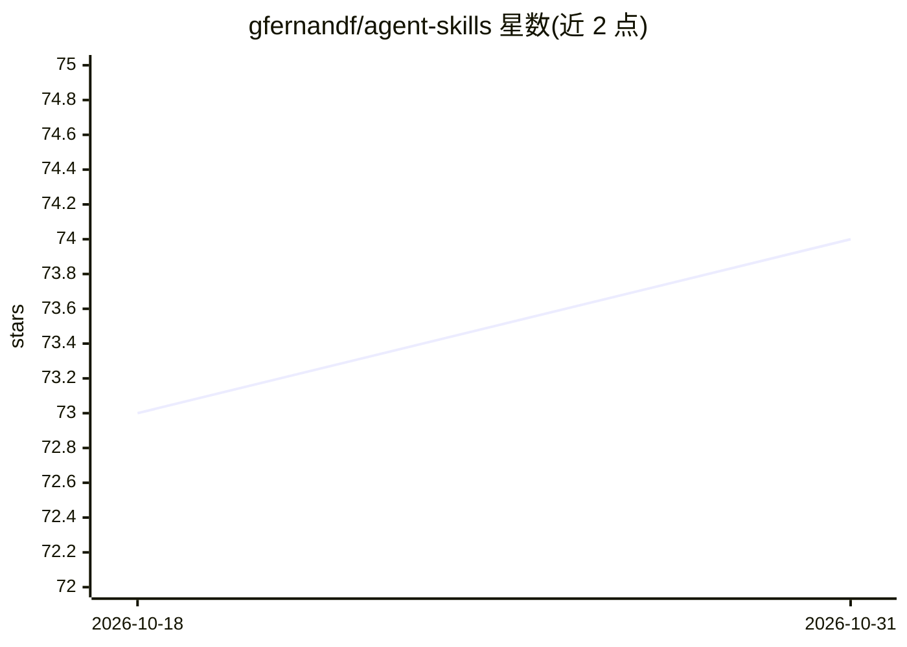

# gfernandf/agent-skills

⭐ 74 · Python · Apache-2.0 · 推送 2026-09-08 · [GitHub](https://github.com/gfernandf/agent-skills) · [官网](https://gfernandf.github.io/agent-skills/) · 个人维护

**把 agent 推理逻辑封装为可执行技能的运行时（ORCA 参考实现）**

Agent Skills Runtime 是 ORCA（Open Cognitive Runtime Architecture）的参考实现，面向开发者把可复用的 agent 推理定义为技能（DAG 工作流）、能力（后端无关契约）与绑定（PythonCall/OpenAPI/MCP/OpenRPC 执行后端），由运行时做 DAG 调度、策略门控、认知状态与追踪。提供嵌入式 SDK、HTTP API、MCP server、框架适配器（LangChain/CrewAI/AutoGen/Semantic Kernel）与原生工具定义（Anthropic/OpenAI/Gemini）等集成方式。本地优先：无需 API key，带确定性 Python 基线可离线运行。以 git clone 源码与 pip 安装方式提供，含研究论文（DOI/SSRN），Apache 2.0 许可。

## 筛选速览

| 维度 | 判定 | 备注 |
|---|---|---|
| AI 角色 | `ai-ecosystem` | LLM/agent 周边工具 |
| 许可风险 | `permissive` | Apache-2.0 |
| 部署形态 | `library` | 以包/库形式分发 |
| 模型依赖 | — | README 未给出锁定关系 |
| 硬件要求 | — | 无带数字的原话,不猜 |
| 安装摩擦 | `low` | 无编译、无系统依赖或容器化 |
| 成熟度 | — | 结构信号不足 |

## 能力要点

- 技能=可复用认知 DAG 工作流，能力=带类型契约，绑定=可替换执行后端
- 运行时提供 DAG 调度、策略/安全门控、CognitiveState 与可追踪执行
- 五种集成面：嵌入式 SDK / HTTP API / MCP server / 框架适配器 / 原生工具定义
- 本地优先运行，无需 API key，带确定性离线基线

## 适用场景

- 把反复写在 prompt 里的推理逻辑沉淀为可测试、可观测的技能
- 在 LangChain/CrewAI/AutoGen 等框架之下作为可复用执行层
- 通过 MCP server 把技能暴露给 MCP 兼容宿主使用
- 离线开发和测试 agent 工作流（确定性基线）

## 场景标签

`Agent 框架` `工作流自动化` · 领域:Agent 开发

## 证据(README 行号)

> L19: Agent Skills Runtime is the reference implementation of ORCA (Open Cognitive Runtime Architecture):
> L24: - Runtime executes DAGs with policy/safety, CognitiveState, and traceability
> L150: - Framework adapters (LangChain, CrewAI, AutoGen, Semantic Kernel)

## 星数曲线

2026-10-18 73 → 2026-10-31 74（+1）

---
*卡片 v1 · prompt 1.4 · 生成 2026-10-24 · 置信度 high · 依据 README sha `1b50f62e4dbf` · [字段定义](../../DATASET.md)*
