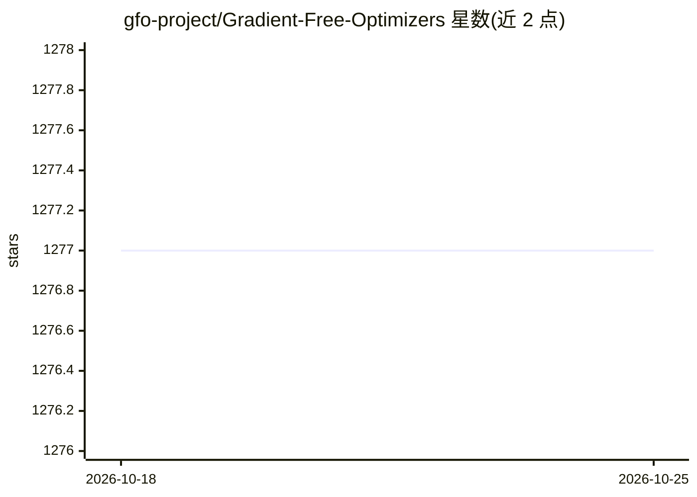

# gfo-project/Gradient-Free-Optimizers

⭐ 1,277 · Python · MIT · 推送 2026-10-10 · [GitHub](https://github.com/gfo-project/Gradient-Free-Optimizers) · [官网](https://gradient-free-optimizers.readthedocs.io/en/latest/) · 个人维护

**黑盒函数无梯度优化库：23 种算法统一接口调参/寻优**

面向黑盒函数无梯度优化的 Python 库，以统一 API 提供 23 种算法，覆盖局部、全局、种群与序列模型式四类（爬山、贝叶斯优化、粒子群、模拟退火等）。支持连续区间、离散网格、类别选项与 SciPy 分布混合的搜索空间，并提供约束函数、记忆缓存、Ask/Tell 接口与提前停止。必需依赖仅 NumPy 与 pandas，SciPy/scikit-learn 可选，可作其他包的优化后端（如 Hyperactive）使用。

## 筛选速览

| 维度 | 判定 | 备注 |
|---|---|---|
| AI 角色 | `ai-ecosystem` | LLM/agent 周边工具 |
| 许可风险 | `permissive` | MIT |
| 部署形态 | `library` | 以包/库形式分发 |
| 模型依赖 | — | README 未给出锁定关系 |
| 硬件要求 | — | 无带数字的原话,不猜 |
| 安装摩擦 | `low` | 无编译、无系统依赖或容器化 |
| 成熟度 | — | 结构信号不足 |

## 能力要点

- 23 种优化算法共享一套统一 API，切换算法仅需改一行
- 混合搜索空间：连续、离散、类别与 SciPy 分布可组合
- 内置记忆缓存避免重复评估，支持暖启动与 Ask/Tell 接口
- 必需依赖仅 NumPy 和 pandas，适合容器与嵌入式环境

## 适用场景

- 机器学习模型超参数调优
- 无法求导的仿真或工程设计参数寻优
- 带约束条件的特征选择与搜索空间受限优化

## 场景标签

 · 领域:优化/机器学习工具

## 证据(README 行号)

> L32: **Gradient-Free-Optimizers** is a Python library for gradient-free optimization of black-box functions. It provides
> L34: Designed for hyperparameter tuning, simulation optimization, feature selection, engineering design, and any scenari

## 星数曲线

2026-10-18 1,277 → 2026-10-25 1,277（+0）

---
*卡片 v1 · prompt 1.4 · 生成 2026-10-21 · 置信度 high · 依据 README sha `adf215ff83ac` · [字段定义](../../DATASET.md)*
