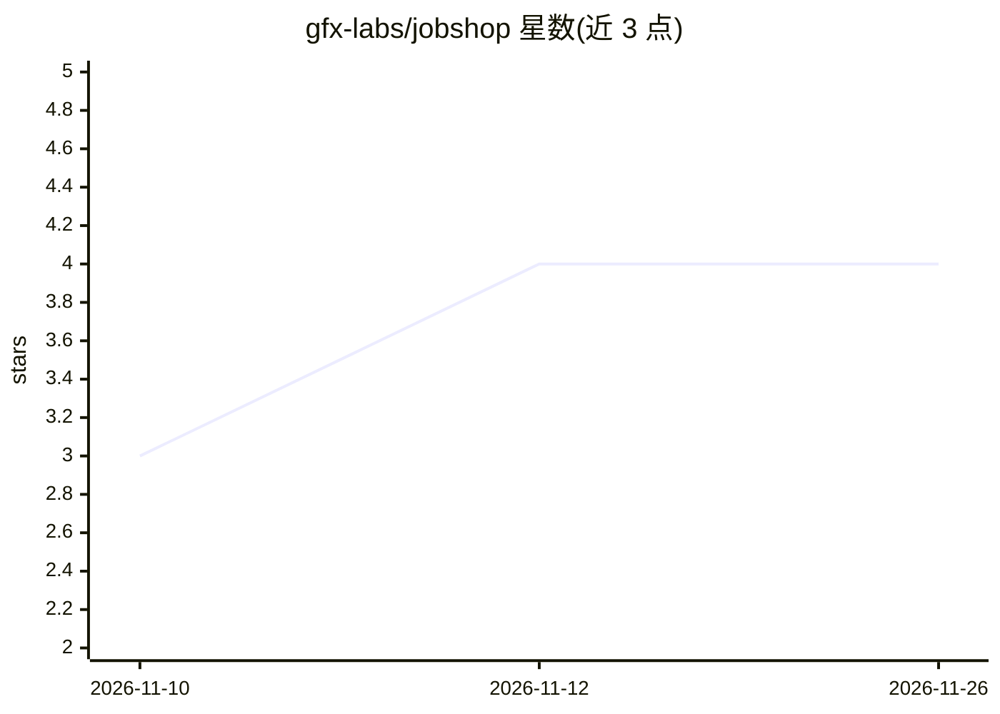

# gfx-labs/jobshop

⭐ 4 · Go · AGPL-3.0 · 推送 2026-11-25 · [GitHub](https://github.com/gfx-labs/jobshop) · 组织维护

**自托管 AI coding agent 编排框架：工单驱动多 agent 工作流**

用 Go 编写的工作流执行框架，单二进制加 SQLite/Postgres 存储，把任务拆为工单（ticket）并交给 agent 会话（经 Agent Client Protocol）认领执行。每个会话运行在独立 git worktree 与沙箱中，工作流跨 agent 池串联步骤，失败重试并升级到人工。提供 GitHub/Linear webhook 接入、cron/事件触发器、Web UI（Desk）与 A2A 网关。自带 issue 到 PR 合并、triage、CI 修复等示例 pack。

## 筛选速览

| 维度 | 判定 | 备注 |
|---|---|---|
| AI 角色 | `ai-ecosystem` | LLM/agent 周边工具 |
| 许可风险 | `viral` | AGPL-3.0 |
| 部署形态 | `library` | 以包/库形式分发 |
| 模型依赖 | — | README 未给出锁定关系 |
| 硬件要求 | — | 无带数字的原话,不猜 |
| 安装摩擦 | `low` | 无编译、无系统依赖或容器化 |
| 成熟度 | — | 结构信号不足 |

## 能力要点

- 工单图（阻塞边、认领、评论）与跨池工作流，含重试与人工升级
- agent 会话各自独立 git worktree 与沙箱，无长期密钥
- GitHub/Linear intake：issue 与评论转工单，PR review/merge 步骤内置
- 触发器支持计数、cron、事件、Starlark handler；提供 Desk Web UI 与 A2A 网关

## 适用场景

- 把 GitHub/Linear issue 自动流转到实现、review、合并的 PR 流水线
- 多 agent 并行认领工单、在沙箱中修改代码
- master 挂掉时按 SHA 自动启动修复 run
- 把历史失败与修正沉淀为后续会话可召回的学习记录

## 场景标签

`编码 Agent` `多智能体` `工作流自动化` · 领域:Agent 开发

## 证据(README 行号)

> L10: Jobshop is a workflow execution framework: it splits work into tickets and
> L23: Agents (any acp, jcode, claude code, gemini cli, etc) claim
> L41: - **GitHub and Linear intake**: webhooks and polling turn issues and comments into tickets; PR review and merge ste

## 星数曲线

2026-11-10 3 → 2026-11-26 4（+1）

---
*卡片 v1 · prompt 1.4 · 生成 2026-11-21 · 置信度 high · 依据 README sha `9023d3ee1ffe` · [字段定义](../../DATASET.md)*
