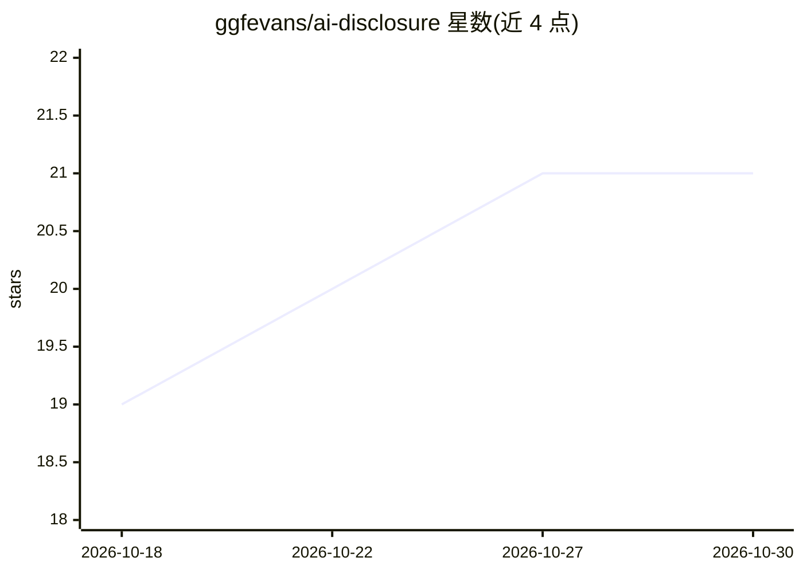

# ggfevans/ai-disclosure

⭐ 21 · CC0-1.0 · 推送 2026-05-17 · [GitHub](https://github.com/ggfevans/ai-disclosure) · 个人维护

**声明源码中 AI 参与程度的机器可读规范（SPDX 行标签）**

组合 W3C AI Content Disclosure 四级词汇（none/ai-assisted/ai-generated/autonomous）与 SPDX 行标签格式形成的轻量规范：文件级用注释行声明披露等级与模型/提供商/范围/日期，仓库级用 AI_DISCLOSURE.md 的 YAML frontmatter 声明默认值；采用最近祖先继承模型，文件标签优先于仓库默认，缺失即 unknown。面向个人开发者与小规模开源项目，提供 JS/TS/Python/Go 示例与模板。声明为 CC0、0.1 草案状态，不评估代码质量，也不满足 EU AI Act 第 50 条要求。

## 筛选速览

| 维度 | 判定 | 备注 |
|---|---|---|
| AI 角色 | `ai-ecosystem` | LLM/agent 周边工具 |
| 许可风险 | `viral` | CC0-1.0 |
| 部署形态 | `None` |  |
| 模型依赖 | — | README 未给出锁定关系 |
| 硬件要求 | — | 无带数字的原话,不猜 |
| 安装摩擦 | `low` | 无编译、无系统依赖或容器化 |
| 成熟度 | `idea` | |

## 能力要点

- 文件级 SPDX-AI-* 行标签，字段名跨语言一致
- AI_DISCLOSURE.md 仓库级 frontmatter + 最近祖先继承
- 四级披露词汇取自 W3C AI Content Disclosure
- 模板与 JS/TS/Python/Go 完整示例文件

## 适用场景

- 在我的开源仓库向使用方声明 AI 参与程度
- 让 CI/linter/包管理器读取机器可读的 AI 出处标签
- 按团队策略统一新文件的 AI 披露标注

## 场景标签

 · 领域:开源治理/规范

## 证据(README 行号)

> L3: A lightweight, machine-readable convention for declaring AI involvement in source code, designed for individual deve
> L5: This convention assembles two stable upstream pieces: the W3C AI Content Disclosure vocabulary and the SPDX line-tag
> L13: Modern open-source code is increasingly written with AI assistance, ranging from light autocomplete to fully genera

## 星数曲线

2026-10-18 19 → 2026-10-30 21（+2）

---
*卡片 v1 · prompt 1.4 · 生成 2026-10-28 · 置信度 high · 依据 README sha `270b54b6c32c` · [字段定义](../../DATASET.md)*
