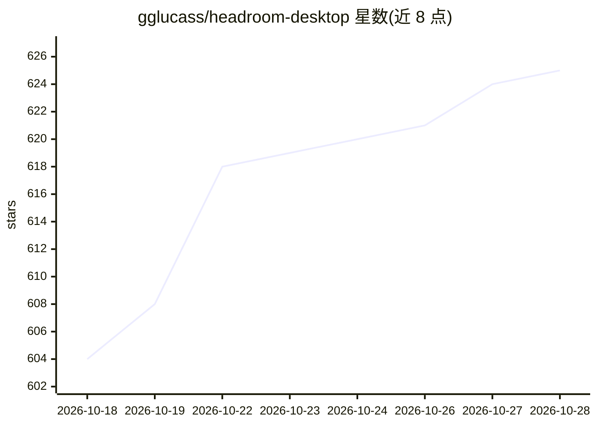

# gglucass/headroom-desktop

⭐ 625 · Rust · MIT · 推送 2026-10-28 · [GitHub](https://github.com/gglucass/headroom-desktop) · [官网](https://extraheadroom.com) · 组织维护

**桌面托盘应用：本地代理压缩 Claude Code/Codex 等的 token 消耗**

面向 macOS/Windows/Linux 的菜单栏/托盘应用，通过 127.0.0.1 两跳本地代理拦截 Claude Code、ChatGPT Codex、OpenCode、Grok Build 的请求，链式调用 headroom 提示优化与 rtk CLI 输出压缩等工具，可逆压缩工具输出、日志与样板内容以降低 token 成本，模型可按需取回原文。附带节省看板、活动流、插件式 addons 与 MCP 工具。注意：付费订阅制（$4/月起），本仓库 MIT 的仅为桌面外壳，运行需账号与有效订阅；Linux 为预览版且不含内存/ML 组件。

## 筛选速览

| 维度 | 判定 | 备注 |
|---|---|---|
| AI 角色 | `ai-ecosystem` | LLM/agent 周边工具 |
| 许可风险 | `permissive` | MIT |
| 部署形态 | `desktop` | 安装包/桌面程序 |
| 模型依赖 | locked-api |  |
| 硬件要求 | — | 无带数字的原话,不猜 |
| 安装摩擦 | `low` | 无编译、无系统依赖或容器化 |
| 成熟度 | `idea` | |

## 能力要点

- 本地两跳代理拦截 4 种编码客户端请求，退出/卸载时可逆还原全部改动
- 链式 token 压缩工具与 8 个本地 addons（markitdown/serena/context7 等）
- 压缩基准：HTML 94.9%、JSON 87.6%、多工具代理 76.3% 压缩
- 托管式自包含 Python 运行时（约 3GB），不污染系统环境

## 适用场景

- 降低 Claude Code / Codex 日常编码的 API token 开销
- 压缩长日志与 JSON 输出以延长 agent 上下文可用量
- 查看按客户端、按日的 token 节省统计

## 场景标签

`提示工程` · 领域:Agent 开发

## 证据(README 行号)

> L56: 2. **Chains token-saving tools** (`headroom` for prompt optimization, `rtk` for CLI output compression) between you
> L67:     |  ANTHROPIC_BASE_URL = http://127.0.0.1:6767

## 星数曲线

2026-10-18 604 → 2026-10-28 625（+21）

---
*卡片 v1 · prompt 1.4 · 生成 2026-10-21 · 置信度 mid · 依据 README sha `4b649d77e66a` · [字段定义](../../DATASET.md)*
