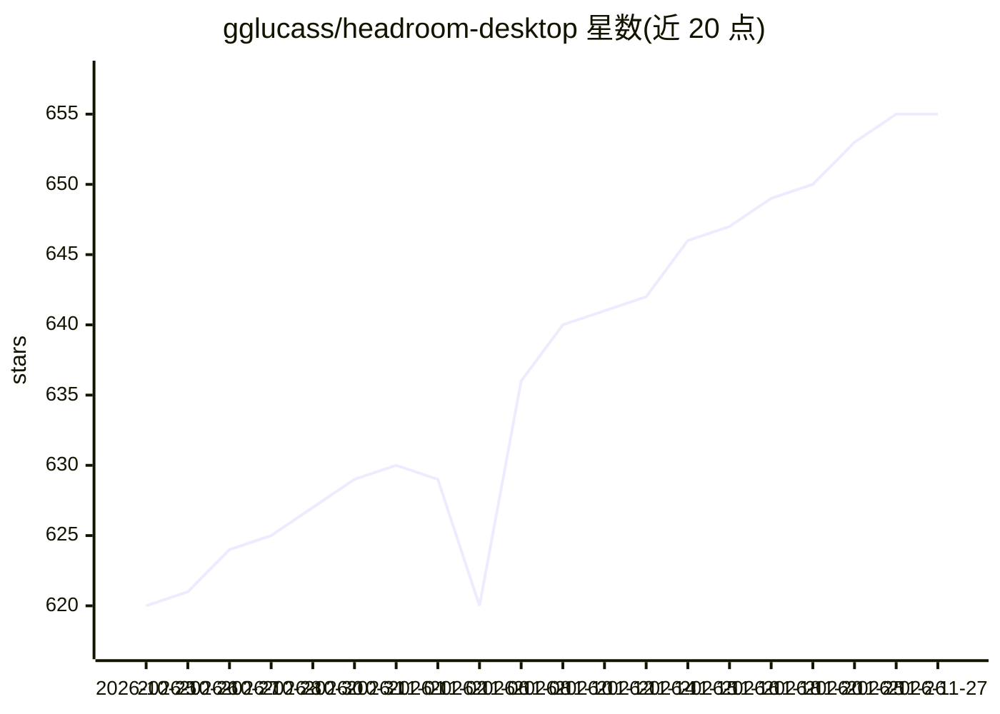

# gglucass/headroom-desktop

⭐ 655 · Rust · MIT · 推送 2026-11-26 · [GitHub](https://github.com/gglucass/headroom-desktop) · [官网](https://extraheadroom.com) · 组织维护

**压缩 Claude Code/Codex 请求 token 的本地代理菜单栏应用**

跨 macOS/Windows/Linux 的托盘应用，以本地两跳代理（127.0.0.1:6767）拦截 Claude Code、ChatGPT Codex、OpenCode、Grok Build 的 API 流量，对工具输出、日志和模板内容做可逆压缩以降低 token 消耗，并提供节省仪表盘、活动流与项目学习记录。应用自动安装隔离的 Python 运行时（约 3 GB），挂载 Claude Code hook 与各客户端 provider 配置，退出/卸载时全部还原。桌面壳 MIT 开源，但运行需 Headroom 订阅账户（7 天试用，$4/月起）。

## 筛选速览

| 维度 | 判定 | 备注 |
|---|---|---|
| AI 角色 | `ai-ecosystem` | LLM/agent 周边工具 |
| 许可风险 | `permissive` | MIT |
| 部署形态 | `desktop` | 安装包/桌面程序 |
| 模型依赖 | — | README 未给出锁定关系 |
| 硬件要求 | — | 无带数字的原话,不猜 |
| 安装摩擦 | `low` | 无编译、无系统依赖或容器化 |
| 成熟度 | — | 结构信号不足 |

## 能力要点

- 本地两跳代理拦截客户端流量，仅最终上游调用离开本机
- 可逆压缩：模型可按需取回原始内容
- 自动管理 Claude Code hook、Codex/OpenCode provider 配置，退出时全部移除
- 内置节省统计仪表盘与按请求压缩活动流

## 适用场景

- 降低 Claude Code / Codex 的 API token 开销
- 多编程客户端统一走同一条本地优化管道
- 查看每日/每月 token 节省与压缩详情

## 场景标签

`编码 Agent` · 领域:编码与开发

## 证据(README 行号)

> L56: 2. **Chains token-saving tools** (`headroom` for prompt optimization, `rtk` for CLI output compression) between you
> L63: Headroom is a two-hop local proxy. Nothing leaves `127.0.0.1` except the final upstream call, which goes to the sam

## 星数曲线

2026-10-25 620 → 2026-11-27 655（+35）

---
*卡片 v1 · prompt 1.4 · 生成 2026-11-24 · 置信度 mid · 依据 README sha `f9e547d2e359` · [字段定义](../../DATASET.md)*
