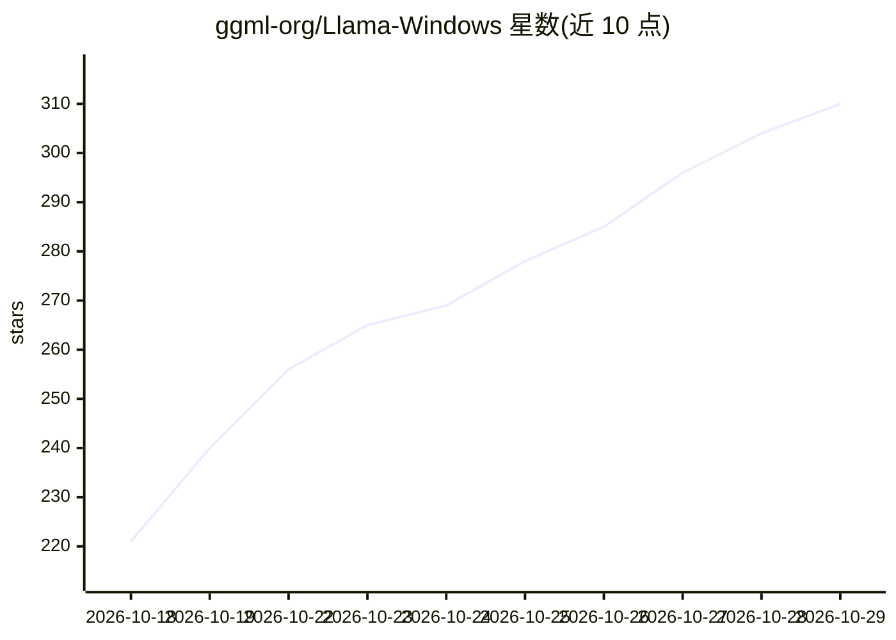

# ggml-org/Llama-Windows

⭐ 310 · C# · MIT · 推送 2026-10-28 · [GitHub](https://github.com/ggml-org/Llama-Windows) · [官网](https://llama.app) · 组织维护

**Windows 11 托盘应用：一键本地运行 llama.cpp 模型并对话**

ggml-org 出品的 WinUI 3 托盘应用，是 Llama for Mac 的 Windows 移植版。它管理一个 llama serve 进程并通过其 REST API 通信，可复用已有 llama.exe 或自动下载；从 Hugging Face Hub 浏览下载模型，存于 HF 标准缓存目录，与其他工具共享。按 Alt+Space 从任意应用唤起悬浮窗与已加载模型对话，推理全部本地进行，无遥测。安装方式为 Releases 中的 .msixbundle（x64/ARM64），从源码构建需 .NET 10 SDK。

## 筛选速览

| 维度 | 判定 | 备注 |
|---|---|---|
| AI 角色 | `ai-ecosystem` | LLM/agent 周边工具 |
| 许可风险 | `permissive` | MIT |
| 部署形态 | `desktop` | 安装包/桌面程序 |
| 模型依赖 | local-ok | 支持本地模型 |
| 硬件要求 | — | 无带数字的原话,不猜 |
| 安装摩擦 | `medium` | 含编译或系统依赖之一 |
| 成熟度 | — | 结构信号不足 |

## 能力要点

- 系统托盘常驻，管理 llama serve 进程并通过其 REST API 通信
- 从 Hugging Face Hub 一键下载推荐模型，存于 HF 标准缓存
- Alt+Space 全局悬浮窗随时与已加载模型对话
- 读取 GGUF 头部提供逐档上下文长度及内存估算，无遥测、推理完全本地

## 适用场景

- 在 Windows 上不开浏览器就快速调用本地 LLM 对话
- 统一管理 llama.cpp 模型下载与 HF 缓存
- 通过全局快捷键在任意应用中唤起 AI 对话

## 场景标签

`AI 助手` · 领域:对话与助手

## 证据(README 行号)

> L5: Llama is a Windows 11 tray app for running llama.cpp models locally. It's a WinUI 3 port of Llama for Mac.
> L30: Llama manages a `llama serve` process and talks to it over its REST API. Your models stay in the standard Hugging F

## 星数曲线

2026-10-18 221 → 2026-10-29 310（+89）

---
*卡片 v1 · prompt 1.4 · 生成 2026-10-22 · 置信度 high · 依据 README sha `e082d2e2f0a6` · [字段定义](../../DATASET.md)*
