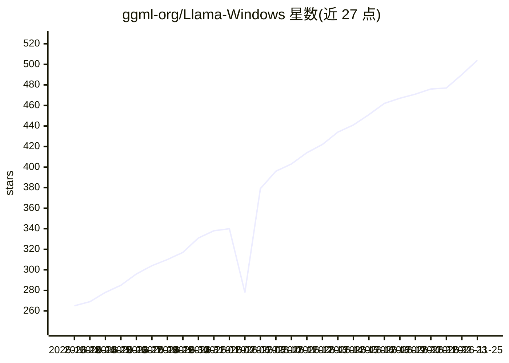

# ggml-org/Llama-Windows

⭐ 504 · C# · MIT · 推送 2026-11-23 · [GitHub](https://github.com/ggml-org/Llama-Windows) · [官网](https://llama.app) · 组织维护

**Windows 11 托盘应用：一键在本地运行 llama.cpp 模型**

Llama 是一个 Windows 11 系统托盘应用，用于本地运行 llama.cpp 模型，是 Llama for Mac 的 WinUI 3 移植版。它管理一个 llama-server 进程并通过其 REST API 通信；可复用已有的 llama.exe，也可自动下载；支持从 Hugging Face Hub 一键下载推荐模型，模型存于标准 HF 缓存目录。提供按内存上限的多模型驻留与 LRU 淘汰、每模型上下文长度选择与 llama.cpp 参数覆盖文件，以及任意应用中按 Alt+Space 呼出的 WebUI 对话浮层。无遥测，推理完全本地。安装包为 x64+ARM64 的 msixbundle，源码构建需 .NET 10 SDK。

## 筛选速览

| 维度 | 判定 | 备注 |
|---|---|---|
| AI 角色 | `ai-ecosystem` | LLM/agent 周边工具 |
| 许可风险 | `permissive` | MIT |
| 部署形态 | `desktop` | 安装包/桌面程序 |
| 模型依赖 | local-ok | 支持本地模型 |
| 硬件要求 | — | 无带数字的原话,不猜 |
| 安装摩擦 | `medium` | 含编译或系统依赖之一 |
| 成熟度 | — | 结构信号不足 |

## 能力要点

- 管理 llama-server 进程并通过 REST API 通信
- 一键从 Hugging Face Hub 下载模型，模型存于标准 HF 缓存
- 按内存上限多模型驻留，LRU 淘汰，无单模型数量上限
- Alt+Space 全局呼出 WebUI 对话浮层，支持每模型 llama.cpp 参数覆盖

## 适用场景

- 在 Windows 上零配置本地运行 llama.cpp 模型
- 从任意应用快速唤出对话窗口与本地模型交流
- 同时加载多个模型并自动按内存调度

## 场景标签

`推理引擎` `AI 助手` · 领域:对话与助手

## 证据(README 行号)

> L3: **Local LLMs, one click away — right from your Windows system tray.**
> L31: Llama manages a `llama serve` process and talks to it over its REST API. Your models stay in the standard Hugging F

## 星数曲线

2026-10-23 265 → 2026-11-25 504（+239）

---
*卡片 v1 · prompt 1.4 · 生成 2026-11-25 · 置信度 high · 依据 README sha `78ecc39e10e6` · [字段定义](../../DATASET.md)*
