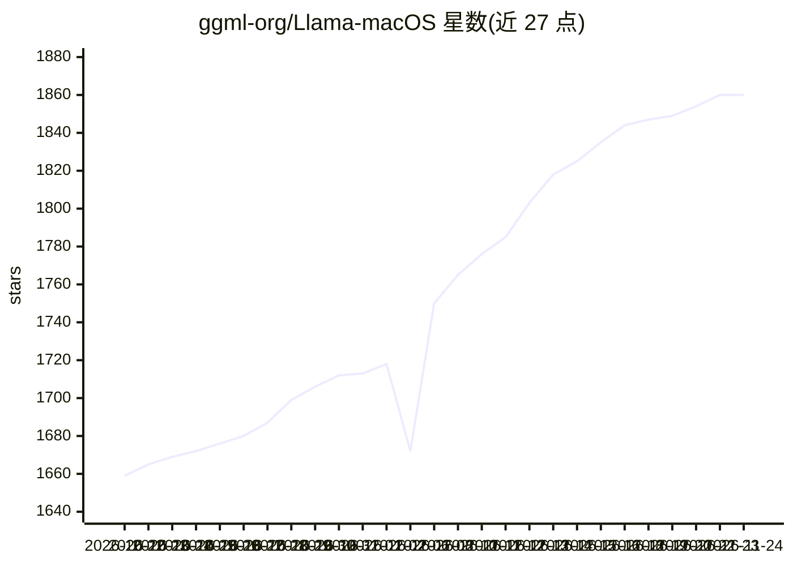

# ggml-org/Llama-macOS

⭐ 1,865 · Swift · MIT · 推送 2026-11-17 · [GitHub](https://github.com/ggml-org/Llama-macOS) · [官网](https://llama.app) · 组织维护

**macOS 菜单栏应用：本地运行与管理 LLM**

ggml-org 出品的 macOS 菜单栏应用，在本地运行 LLM。启动后在 localhost:9931 暴露 OpenAI 风格 API，内置 WebUI 聊天，也可供其他应用（编码 agent、聊天 UI、编辑器）接入。基于 llama.cpp 构建，可复用已装的 llama.cpp 二进制与 Hugging Face 缓存，按 Mac 硬件推荐并一键安装 GGUF 模型，模型按需加载、空闲卸载。应用本体 4 MB，提供 brew cask 安装。

## 筛选速览

| 维度 | 判定 | 备注 |
|---|---|---|
| AI 角色 | `ai-ecosystem` | LLM/agent 周边工具 |
| 许可风险 | `permissive` | MIT |
| 部署形态 | `None` |  |
| 模型依赖 | local-ok | 支持本地模型 |
| 硬件要求 | — | 无带数字的原话,不猜 |
| 安装摩擦 | `low` | 无编译、无系统依赖或容器化 |
| 成熟度 | — | 结构信号不足 |

## 能力要点

- 100% 本地运行，数据不出 Mac
- 内置 WebUI 与标准 API（/v1/chat/completions）
- 按硬件推荐模型并一键安装 GGUF
- models.user.ini 自定义模型参数与草稿模型

## 适用场景

- 在 Mac 上托管本地模型供编码 agent 等工具调用
- 通过 WebUI 与任意本地 GGUF 模型对话
- Tailscale 下从其他设备访问家中模型

## 场景标签

`推理引擎` `聊天机器人` · 领域:对话与助手

## 证据(README 行号)

> L3: Llama is a macOS menu bar app for running local LLMs.
> L21: If you have llama.cpp installed, Llama uses it. Otherwise, it installs a prebuilt binary for your Mac. Models you'v
> L23: You can chat with any model in the built-in WebUI, connect other apps (coding agents, chat UIs, editors), or use th

## 星数曲线

2026-10-22 1,659 → 2026-11-24 1,860（+201）

---
*卡片 v1 · prompt 1.4 · 生成 2026-11-23 · 置信度 high · 依据 README sha `1d9899f9e0f6` · [字段定义](../../DATASET.md)*
