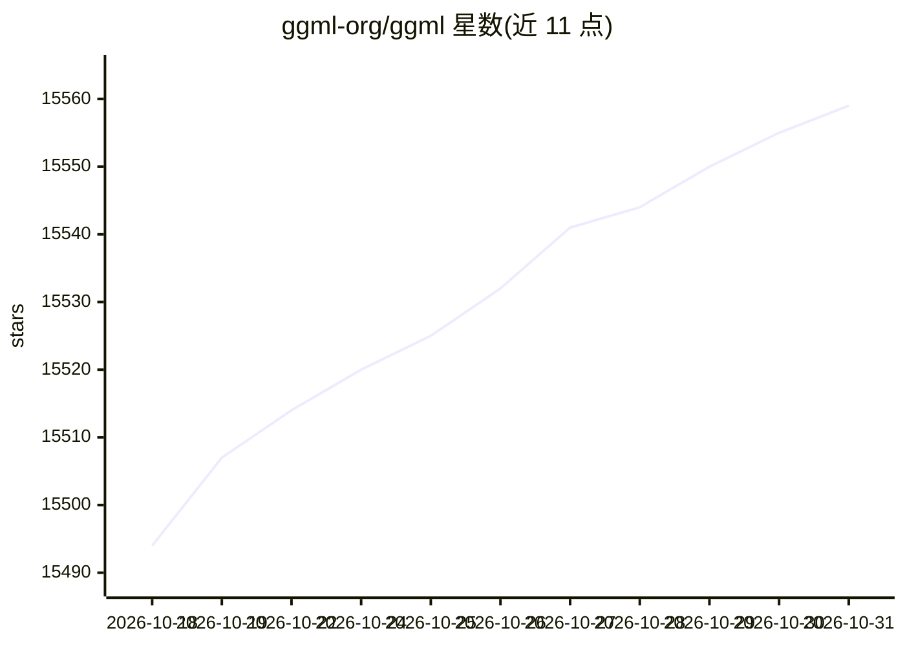

# ggml-org/ggml

⭐ 15,559 · C++ · MIT · 推送 2026-10-28 · [GitHub](https://github.com/ggml-org/ggml) · [官网](https://github.com/ggml-org) · 组织维护

**面向机器学习的 C/C++ 张量计算库**

以纯 C/C++ 实现的机器学习张量库，目标是简单、可移植、高效且安装配置最少。无任何外部依赖，支持 x86、ARM、RISC-V、LoongArch、PowerPC、s390x 与 WebAssembly 多平台，为 x86/ARM/RISC-V 提供 SIMD 优化内核；后端覆盖 CPU、GPU、NPU 与浏览器，支持 2-8 位整数量化及 MXFP4/NVFP4 微缩格式，运行期零内存分配。通过 CMake 从源码构建，MIT 协议。

## 筛选速览

| 维度 | 判定 | 备注 |
|---|---|---|
| AI 角色 | `ai-ecosystem` | LLM/agent 周边工具 |
| 许可风险 | `permissive` | MIT |
| 部署形态 | `None` |  |
| 模型依赖 | — | README 未给出锁定关系 |
| 硬件要求 | — | 无带数字的原话,不猜 |
| 安装摩擦 | `medium` | 含编译或系统依赖之一 |
| 成熟度 | — | 结构信号不足 |

## 动量与使用信号

- 维护:`active` — 距上次 push 2.8 天,年发版 39,442 位贡献者
- 涨星:近 1 天 **+8**(自 20261016 起算)
- 安装:github 包 `release-assets` 月下载无数据

## 能力要点

- 纯 C/C++ 实现，无外部依赖
- 跨平台支持 x86、ARM、RISC-V 等 7 类架构与 WebAssembly
- 后端覆盖 CPU、GPU、NPU 与浏览器
- 支持 2-8 位整数量化与 MXFP4/NVFP4 格式

## 适用场景

- 在多种硬件平台上部署机器学习推理计算
- 为需要无依赖、可移植性的项目提供张量运算底座
- 在受限环境（如浏览器）中运行机器学习计算

## 场景标签

 · 领域:机器学习基础设施

## 证据(README 行号)

> L28: The main goal of `ggml` is to be a simple, portable, and efficient tensor library for machine learning with minimal
> L33: - Broad backend support - CPU, GPU, NPU, and browser

## 星数曲线

2026-10-18 15,494 → 2026-10-31 15,559（+65）

---
*卡片 v1 · prompt 1.4 · 生成 2026-10-18 · 置信度 high · 依据 README sha `e0b7aec07fdc` · [字段定义](../../DATASET.md)*
