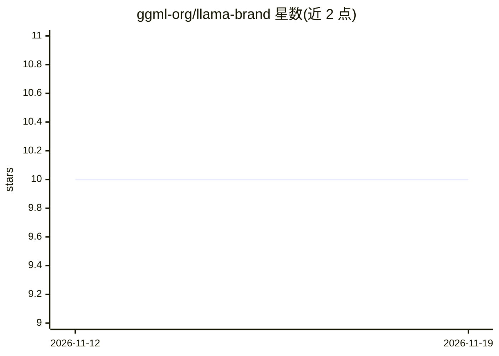

# ggml-org/llama-brand

⭐ 10 · Svelte · NOASSERTION · 推送 2026-11-18 · [GitHub](https://github.com/ggml-org/llama-brand) · [官网](https://ggml-org-llama-brand-storybook.static.hf.space) · 组织维护

**Llama 与 llama.cpp 的官方品牌素材库：logo、字体与配色**

ggml-org 发布的品牌资产仓库，收录 Llama.app 与 llama.cpp 的 logo（SVG/WebP/PNG 多格式与多平台应用图标、社交头像）、两款字体 Llama Sans 与 Llama Mono（SIL OFL 1.1）、品牌色 token 与 CSS 文件，以及承载这些素材的 Storybook。通过 npm 包 @ggml-org/llama-brand 发布，可按路径导入文件；另附面向 agent 撰写的品牌手册 BRAND.md。logo 资产采用 CC BY-NC 4.0 许可。

## 筛选速览

| 维度 | 判定 | 备注 |
|---|---|---|
| AI 角色 | `ai-ecosystem` | LLM/agent 周边工具 |
| 许可风险 | `none` | NOASSERTION |
| 部署形态 | `library` | 以包/库形式分发 |
| 模型依赖 | — | README 未给出锁定关系 |
| 硬件要求 | — | 无带数字的原话,不猜 |
| 安装摩擦 | `low` | 无编译、无系统依赖或容器化 |
| 成熟度 | — | 结构信号不足 |

## 能力要点

- logo 素材覆盖 SVG、WebP、PNG 三种格式及 iOS/macOS/Android/Windows/PWA 图标
- Llama Sans 可变字体（400–700，光学尺寸轴 10–36）与 Llama Mono，SIL OFL 1.1 许可
- CSS 提供色彩 token、@font-face 与通信物料的版式系统
- Storybook 为素材来源，master 分支变更经 CI 构建发布至 Hugging Face Space

## 适用场景

- 为基于 llama.cpp 的应用或文档使用官方 logo 与图标
- 在网页或 UI 中通过 CSS 导入品牌字体与配色
- 设计帖子、海报、商店截图等品牌物料时取用版式系统

## 场景标签

 · 领域:设计/品牌资产

## 证据(README 行号)

> L3: Official brand assets for **Llama.app** and **llama.cpp**: the logo, the Llama type family, and the colours and core
> L186: The brand is drawn in a Storybook with its own files and the components Llama Chat is built from (`@ggml-org/llama

## 星数曲线

2026-11-12 10 → 2026-11-19 10（+0）

---
*卡片 v1 · prompt 1.4 · 生成 2026-11-19 · 置信度 mid · 依据 README sha `bc30e279399d` · [字段定义](../../DATASET.md)*
