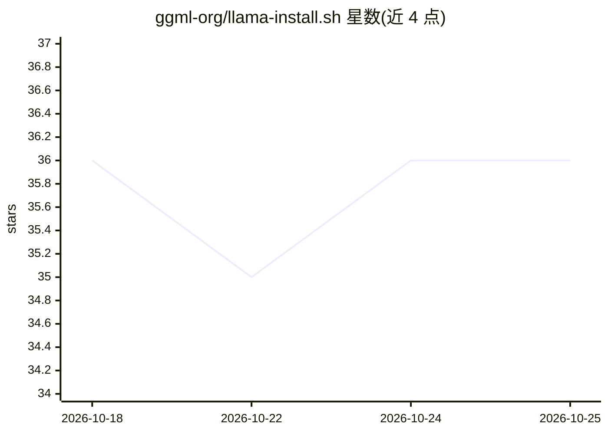

# ggml-org/llama-install.sh

⭐ 36 · Python · MIT · 推送 2026-10-23 · [GitHub](https://github.com/ggml-org/llama-install.sh) · 组织维护

**一键安装预编译 llama.cpp 二进制的跨平台安装脚本**

提供 install.sh 与 install.ps1 脚本，自动检测 OS、架构（x86_64/aarch64）与 GPU 能力（CUDA/ROCm/Vulkan/Metal），下载并安装预编译 llama 二进制到本地。安装后可运行 llama serve 从 HuggingFace 拉取 GGUF 模型启动推理服务，浏览器访问 127.0.0.1:8080 使用。支持 Linux/macOS/FreeBSD/Windows，可用环境变量跳过特定后端检测。面向希望快速部署 llama.cpp 的用户。

## 筛选速览

| 维度 | 判定 | 备注 |
|---|---|---|
| AI 角色 | `ai-ecosystem` | LLM/agent 周边工具 |
| 许可风险 | `permissive` | MIT |
| 部署形态 | `desktop` | 安装包/桌面程序 |
| 模型依赖 | — | README 未给出锁定关系 |
| 硬件要求 | — | 无带数字的原话,不猜 |
| 安装摩擦 | `medium` | 含编译或系统依赖之一 |
| 成熟度 | — | 结构信号不足 |

## 能力要点

- 自动检测 OS、架构与 CPU/GPU 加速（CUDA/ROCm/Vulkan/Metal）
- POSIX 与 Windows PowerShell 各提供一行安装命令
- 预编译二进制免本地构建
- 支持 SKIP_CUDA/SKIP_ROCM/SKIP_VULKAN 跳过后端检测

## 适用场景

- 不想本地编译，快速装好可运行的 llama.cpp
- 按显卡自动选择 GPU 加速后端部署推理服务
- 一行命令启动 GGUF 模型并在浏览器中使用

## 场景标签

`推理引擎` · 领域:训练与推理

## 证据(README 行号)

> L3: Build and install scripts for llama.app
> L6: It automatically detects your OS, architecture, and GPU capabilities, so you can start using `llama.cpp` in seconds.

## 星数曲线

2026-10-18 36 → 2026-10-25 36（+0）

---
*卡片 v1 · prompt 1.4 · 生成 2026-10-25 · 置信度 high · 依据 README sha `d1e2dfa564ec` · [字段定义](../../DATASET.md)*
