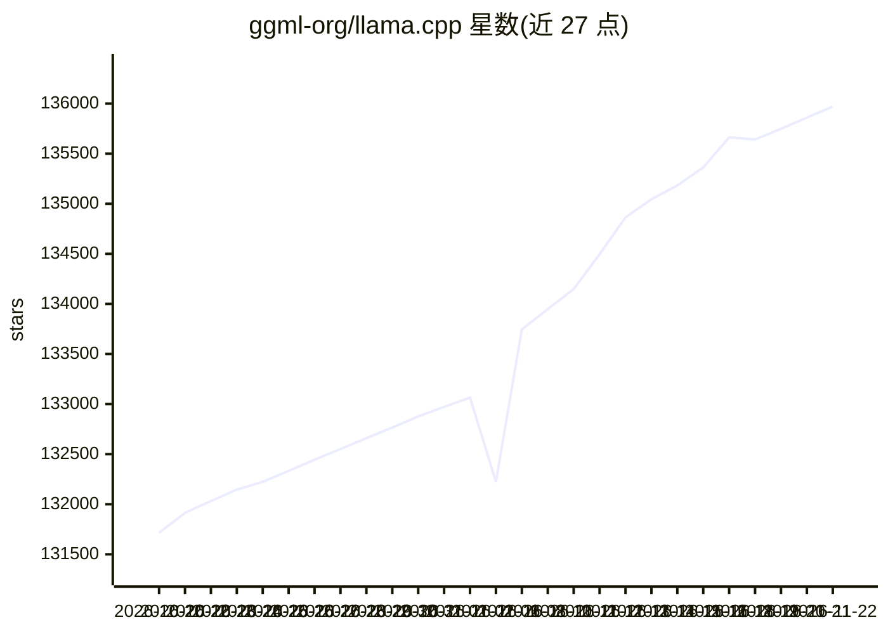

# ggml-org/llama.cpp

⭐ 135,971 · C++ · MIT · 推送 2026-11-21 · [GitHub](https://github.com/ggml-org/llama.cpp) · [官网](https://llama.app) · 组织维护

**面向本地/云端开发者的 C/C++ LLM 推理运行时**

基于 ggml 库构建的 LLM（及多模态 LLM）推理项目，目标是以最小配置在广泛硬件上本地或云端运行模型。提供 curl/powershell 安装脚本、Docker、预编译二进制与源码构建多种途径；工具链包含 cli、completion、server（OpenAI 兼容 REST API）、TTS 模型支持与 GBNF 语法。文档覆盖 Android 构建、多 GPU 使用、性能排查与 XCFramework 等，采用 MIT 许可。

## 筛选速览

| 维度 | 判定 | 备注 |
|---|---|---|
| AI 角色 | `ai-ecosystem` | LLM/agent 周边工具 |
| 许可风险 | `permissive` | MIT |
| 部署形态 | `desktop` | 安装包/桌面程序 |
| 模型依赖 | — | README 未给出锁定关系 |
| 硬件要求 | — | 无带数字的原话,不猜 |
| 安装摩擦 | `low` | 无编译、无系统依赖或容器化 |
| 成熟度 | — | 结构信号不足 |

## 动量与使用信号

- 维护:`active` — 距上次 push 0.6 天,年发版 100,445 位贡献者
- 涨星:近 1 天 **+145**(自 20261016 起算)
- 下载:GitHub Release 附件 累计 508,430(100 个 release)
- 平台:WEB · 协议:OPENAI-API

## 能力要点

- 本地与云端、多种硬件上的 LLM/MLLM 推理
- llama serve 提供 OpenAI 兼容 API 服务器
- 支持从 Hugging Face 直接下载并运行 GGUF 模型
- 提供 cli/completion/server/TTS/GBNF 等工具链

## 适用场景

- 在一台笔记本上离线运行 GGUF 格式模型
- 本地起一个 OpenAI 兼容 API 给自己的应用调用
- 在多 GPU 或 Android 设备上部署推理

## 场景标签

`推理引擎` · 领域:训练与推理

## 证据(README 行号)

> L18: The main goal of `llama.cpp` is to enable LLM (and MLLM) inference with minimal setup and state-of-the-art performa
> L45: # Launch OpenAI-compatible API server
> L46: llama serve -hf ggml-org/Qwen3.5-0.8B-GGUF

## 星数曲线

2026-10-20 131,715 → 2026-11-22 135,971（+4,256）

---
*卡片 v1 · prompt 1.4 · 生成 2026-11-22 · 置信度 high · 依据 README sha `5ba43d3d2cba` · [字段定义](../../DATASET.md)*
