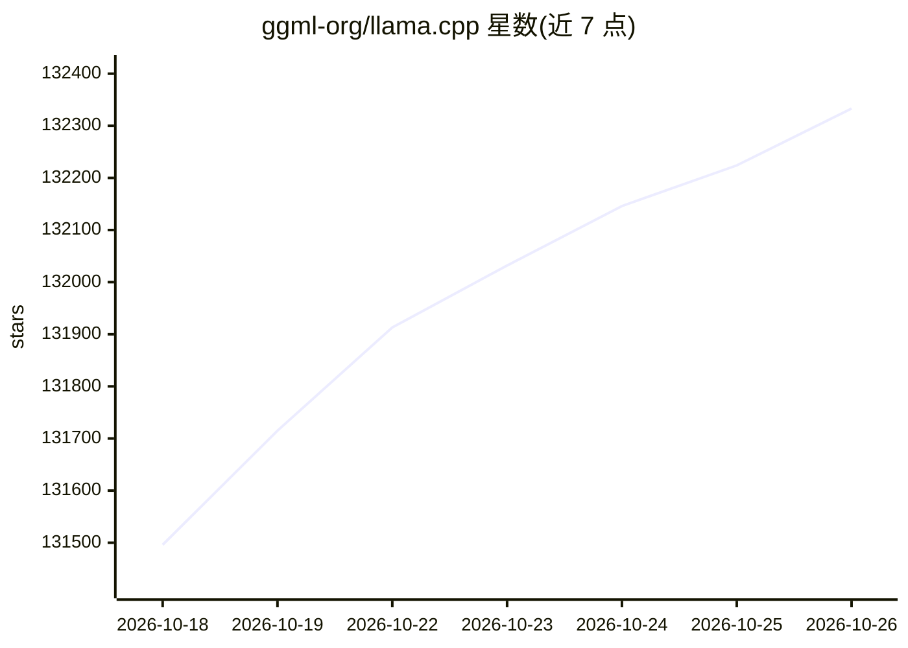

# ggml-org/llama.cpp

⭐ 132,333 · C++ · MIT · 推送 2026-10-25 · [GitHub](https://github.com/ggml-org/llama.cpp) · [官网](https://llama.app) · 组织维护

**让开发者在本地和云端多种硬件上运行 LLM/VLM 推理**

以 C/C++ 实现的 LLM（含 VLM）推理项目，目标是以最小配置在广泛硬件上运行推理。核心机制包括：无依赖的纯 C/C++ 实现、1.5-bit 到 8-bit 整数量化以降低内存占用、CPU+GPU 混合推理，以及 CUDA/HIP/MUSA/Metal/Vulkan/SYCL 等多后端。提供 cli 与 server 等工具，server 提供 OpenAI 兼容 API 与内置 Web UI。基于 ggml 库构建，MIT 许可，可经安装脚本、Docker、预编译二进制或源码构建获取。

## 筛选速览

| 维度 | 判定 | 备注 |
|---|---|---|
| AI 角色 | `ai-ecosystem` | LLM/agent 周边工具 |
| 许可风险 | `permissive` | MIT |
| 部署形态 | `desktop` | 安装包/桌面程序 |
| 模型依赖 | — | README 未给出锁定关系 |
| 硬件要求 | — | 无带数字的原话,不猜 |
| 安装摩擦 | `medium` | 含编译或系统依赖之一 |
| 成熟度 | — | 结构信号不足 |

## 动量与使用信号

- 维护:`active` — 距上次 push 0.6 天,年发版 100,445 位贡献者
- 涨星:近 1 天 **+145**(自 20261016 起算)
- 下载:GitHub Release 附件 累计 508,430(100 个 release)
- 平台:WEB · 协议:OPENAI-API

## 能力要点

- 纯 C/C++ 实现且无依赖，支持从 1.5-bit 到 8-bit 的整数量化
- 覆盖 CUDA、HIP、MUSA、Metal、Vulkan、SYCL 等多后端与多架构指令集
- CPU+GPU 混合推理，可运行超过总 VRAM 容量的模型
- llama serve 提供 OpenAI 兼容 API 与内置 Web UI

## 适用场景

- 在本地笔记本或台式机上运行 GGUF 格式的大语言模型
- 通过 OpenAI 兼容 API server 为应用提供推理服务
- 在 Apple Silicon、NVIDIA/AMD GPU、RISC-V 等多种硬件上部署推理
- 用量化模型在显存受限设备上运行较大模型

## 场景标签

`推理引擎` `模型量化` · 领域:训练与推理

## 证据(README 行号)

> L5:  LLM inference in C/C++
> L51: The main goal of `llama.cpp` is to enable LLM (and VLM) inference with minimal setup and state-of-the-art performan
> L54: - Plain C/C++ implementation without any dependencies

## 星数曲线

2026-10-18 131,496 → 2026-10-26 132,333（+837）

---
*卡片 v1 · prompt 1.4 · 生成 2026-10-18 · 置信度 high · 依据 README sha `5c6741a9d8d6` · [字段定义](../../DATASET.md)*
