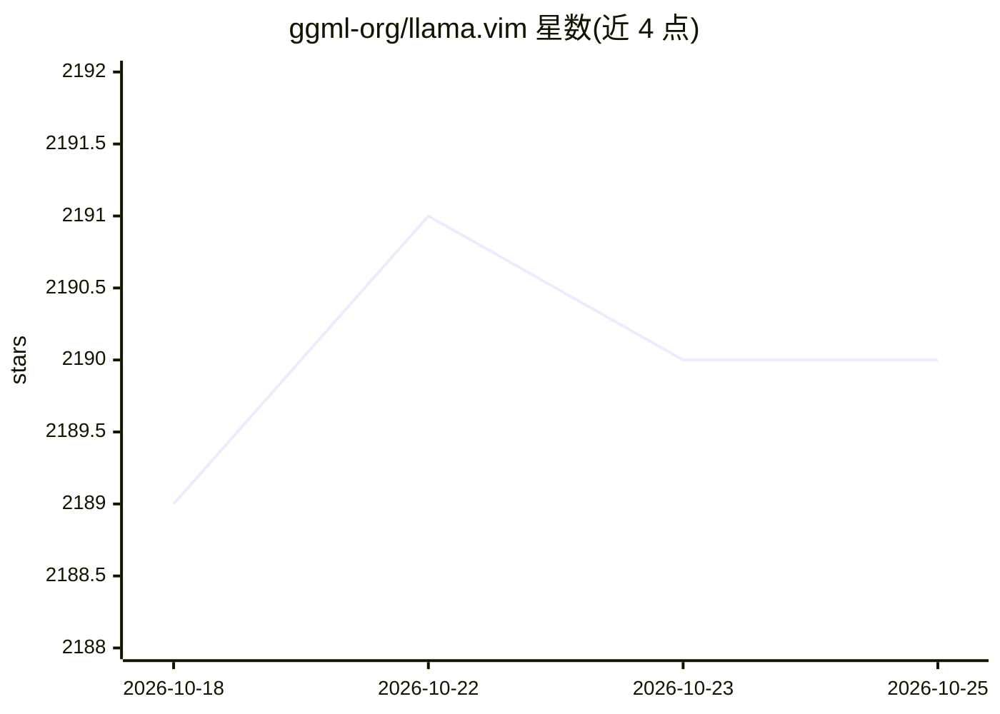

# ggml-org/llama.vim

⭐ 2,190 · Vim Script · MIT · 推送 2026-09-29 · [GitHub](https://github.com/ggml-org/llama.vim) · 组织维护

**Vim 插件：通过本地 llama.cpp 实现 LLM 代码/文本补全**

为 Vim/Neovim 提供本地 LLM 辅助补全的插件：插入模式移动光标时自动给出 Fill-in-the-Middle 建议，Tab/Shift+Tab 接受；支持基于指令的编辑、自定义生成时间与上下文范围、来自打开文件与 yank 文本的环形上下文缓冲，并通过智能上下文复用在低配硬件上支持大上下文。插件自身不含模型，需连接 llama.cpp 服务器实例（endpoint 可配置多 profile 切换），并要求 FIM 兼容模型。安装经 vim-plug/Vundle/lazy.nvim，llama.cpp 侧可经 brew/winget 安装。

## 筛选速览

| 维度 | 判定 | 备注 |
|---|---|---|
| AI 角色 | `ai-native` | 本体是模型或模型工具 |
| 许可风险 | `permissive` | MIT |
| 部署形态 | `None` |  |
| 模型依赖 | — | README 未给出锁定关系 |
| 硬件要求 | — | 无带数字的原话,不猜 |
| 安装摩擦 | `low` | 无编译、无系统依赖或容器化 |
| 成熟度 | — | 结构信号不足 |

## 能力要点

- 插入模式自动 FIM 补全，Tab 接受建议
- 基于指令的编辑（instruction-based editing）
- 环形上下文缓冲：聚合打开/编辑过的文件与 yank 文本
- 智能上下文复用，在低端硬件上支持大上下文

## 适用场景

- 在 Vim 中获得本地 LLM 代码补全，无需云端服务
- 跨文件维护全局上下文，在大型代码库中补全
- 按指令对代码文本进行编辑改写

## 场景标签

`代码生成` · 领域:编码与开发

## 证据(README 行号)

> L7: Local LLM-assisted text completion.
> L23: - Auto-suggest on cursor movement in `Insert` mode
> L143: The plugin requires a llama.cpp server instance to be running at `g:llama_config.endpoint_fim` and/or `g:llama_con

## 星数曲线

2026-10-18 2,189 → 2026-10-25 2,190（+1）

---
*卡片 v1 · prompt 1.4 · 生成 2026-10-21 · 置信度 high · 依据 README sha `798b463e0fe4` · [字段定义](../../DATASET.md)*
