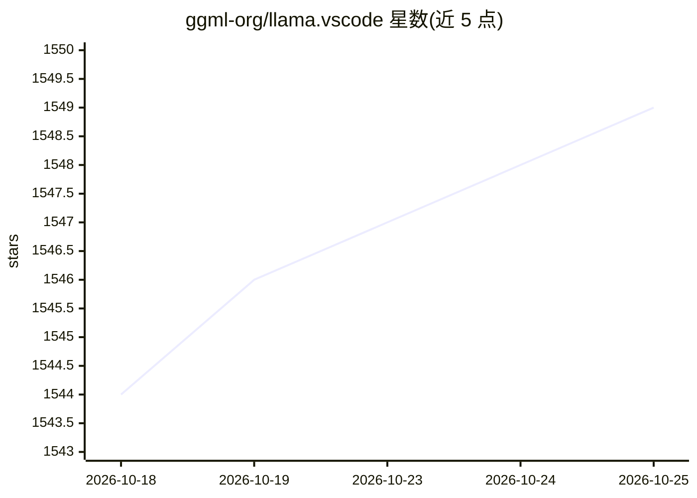

# ggml-org/llama.vscode

⭐ 1,550 · TypeScript · MIT · 推送 2026-10-25 · [GitHub](https://github.com/ggml-org/llama.vscode) · 组织维护

**VS Code 本地 LLM 代码补全与 Agent 编程扩展**

ggml.org 维护的 VS Code 扩展，基于 llama.cpp 提供本地 FIM 代码/文本补全、聊天与 Llama Agent 代理式编程；支持 Tab 逐词/逐行接受建议、上下文环绕与智能上下文复用（低配硬件可用大上下文）、性能统计显示。Agent 可用本地模型（如 gpt-oss 20B）或外部模型（OpenRouter），支持 MCP 工具与自定义 JS 工具，可通过 Telegram bot 从手机访问。llama.cpp 依赖可由扩展自动安装（brew/winget），也支持手动安装与 CPU-only 配置。

## 筛选速览

| 维度 | 判定 | 备注 |
|---|---|---|
| AI 角色 | `ai-native` | 本体是模型或模型工具 |
| 许可风险 | `permissive` | MIT |
| 部署形态 | `None` |  |
| 模型依赖 | local-ok | 支持本地模型 |
| 硬件要求 | — | 无带数字的原话,不猜 |
| 安装摩擦 | `low` | 无编译、无系统依赖或容器化 |
| 成熟度 | — | 结构信号不足 |

## 能力要点

- 基于 llama.cpp 的本地 FIM 补全，含智能上下文复用
- Llama Agent 代理式编程，支持 MCP 工具与自定义 JS 工具
- 模型/环境组（env）的添加、导入导出与选择管理
- 从 Hugging Face 搜索下载模型，支持 Telegram bot 远程访问

## 适用场景

- 在 VS Code 中获得本地离线代码补全
- 用本地模型跑代理式编程助手处理编码任务
- 低显存或 CPU 机器上运行轻量本地补全

## 场景标签

`代码生成` `编码 Agent` · 领域:编码与开发

## 证据(README 行号)

> L3: Local LLM-assisted text completion, chat with AI and agentic coding extension for VS Code
> L21: - Llama Agent for agentic coding

## 星数曲线

2026-10-18 1,544 → 2026-10-25 1,549（+5）

---
*卡片 v1 · prompt 1.4 · 生成 2026-10-21 · 置信度 high · 依据 README sha `1b18c87797a6` · [字段定义](../../DATASET.md)*
