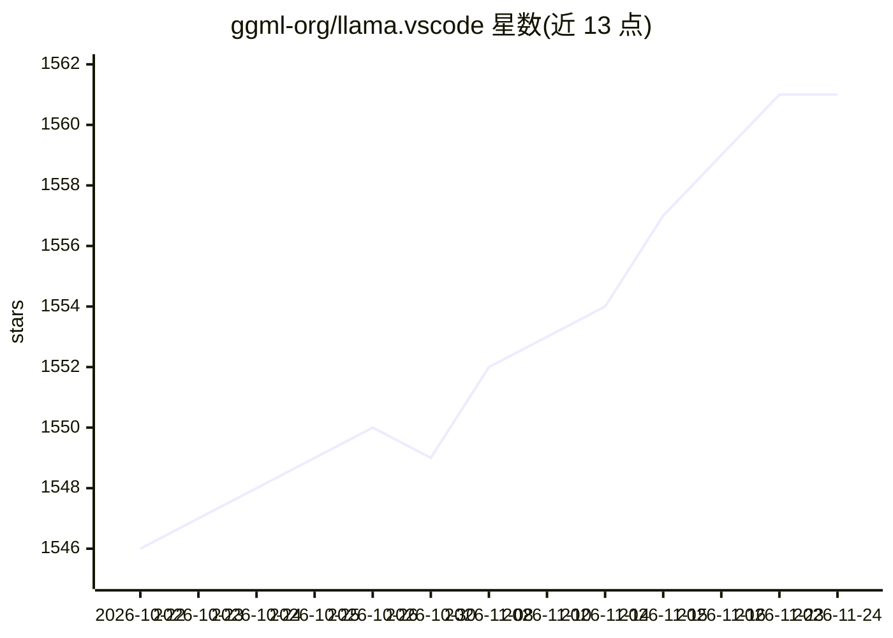

# ggml-org/llama.vscode

⭐ 1,561 · TypeScript · MIT · 推送 2026-11-20 · [GitHub](https://github.com/ggml-org/llama.vscode) · 组织维护

**本地 LLM 代码补全与 Agent 编码的 VS Code 扩展**

基于 llama.cpp 的 VS Code 扩展，提供输入时的自动文本补全（FIM）、聊天与 Llama Agent 编码功能。补全侧支持 Tab/方向键接受建议、上下文环形缓冲、大上下文的智能复用与性能统计；模型可从 Hugging Face 下载或使用预定义本地/外部模型，按补全/聊天/嵌入/工具分类管理，并以 Env 分组。扩展启动时可自动安装 llama.cpp，也支持手动 brew/winget 安装。Agent 内置 9 个工具、支持 MCP 工具与 JavaScript 自定义工具，并可经 Telegram bot 远程访问。

## 筛选速览

| 维度 | 判定 | 备注 |
|---|---|---|
| AI 角色 | `ai-ecosystem` | LLM/agent 周边工具 |
| 许可风险 | `permissive` | MIT |
| 部署形态 | `None` |  |
| 模型依赖 | local-ok | 支持本地模型 |
| 硬件要求 | `gpu-24g` | |
| 安装摩擦 | `low` | 无编译、无系统依赖或容器化 |
| 成熟度 | — | 结构信号不足 |

## 能力要点

- 本地 FIM 补全，支持低配硬件下的智能上下文复用
- Llama Agent：9 个内置工具、MCP 工具与 JS 自定义工具
- 从 Hugging Face 搜索下载模型，按 Env 分组管理补全/聊天/嵌入/工具模型
- 支持 Telegram bot 手机端访问 Agent 及 vscode:// 深链

## 适用场景

- 在 VS Code 中用本地模型做代码补全而无需云服务
- 用 Agent 在编辑器内执行多步编码任务并调用 MCP 工具
- 按显存大小选择不同规模的 FIM 模型运行

## 场景标签

`代码生成` `编码 Agent` · 领域:编码与开发

## 证据(README 行号)

> L3: Local LLM-assisted text completion, chat with AI and agentic coding extension for VS Code
> L51: Show llama-vscode menu by clicking on llama-vscode in the status bar or Ctrl+Shift+M and select "Install/Upgrade ll

## 星数曲线

2026-10-22 1,546 → 2026-11-24 1,561（+15）

---
*卡片 v1 · prompt 1.4 · 生成 2026-11-24 · 置信度 high · 依据 README sha `56f886f5dde4` · [字段定义](../../DATASET.md)*
