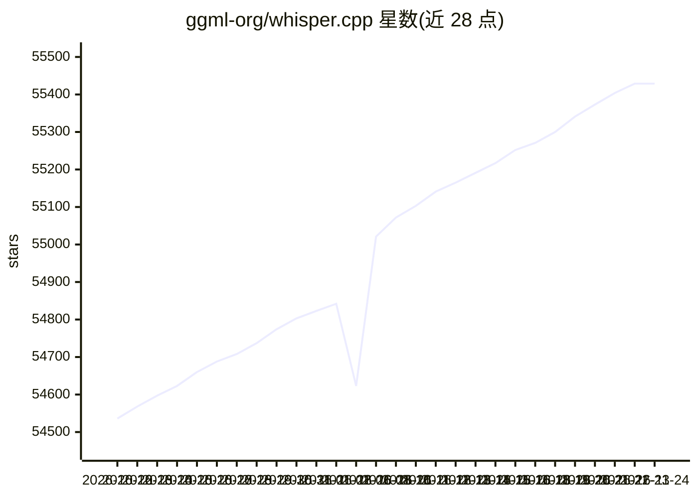

# ggml-org/whisper.cpp

⭐ 55,457 · C++ · MIT · 推送 2026-11-23 · [GitHub](https://github.com/ggml-org/whisper.cpp) · 组织维护

**OpenAI Whisper 语音识别模型的 C/C++ 推理实现**

以纯 C/C++ 无依赖实现 OpenAI Whisper 自动语音识别（ASR）模型的高性能推理，核心实现位于 whisper.h/whisper.cpp，其余基于 ggml 机器学习库。支持 CPU 推理、Apple Silicon（Metal/Core ML/ANE）、NVIDIA CUDA、Vulkan、AMD Ryzen AI NPU、OpenVINO 等后端，并提供整数量化、F16/F32 混合精度与 VAD。支持 macOS/iOS/Android/Linux/Windows/WebAssembly 等平台，模型需转换为 ggml 格式，whisper-cli 示例仅接受 16 位 WAV 输入。

## 筛选速览

| 维度 | 判定 | 备注 |
|---|---|---|
| AI 角色 | `ai-native` | 本体是模型或模型工具 |
| 许可风险 | `permissive` | MIT |
| 部署形态 | `desktop` | 安装包/桌面程序 |
| 模型依赖 | local-ok | 支持本地模型 |
| 硬件要求 | `cpu-ok` | |
| 安装摩擦 | `high` | 编译与系统依赖俱全 |
| 成熟度 | — | 结构信号不足 |

## 动量与使用信号

- 维护:`active` — 距上次 push 6.1 天,年发版 15,445 位贡献者
- 涨星:近 1 天 **+21**(自 20261016 起算)
- 安装:pypi 包 `ane_transformers` 月下载 2,151
- 平台:WINDOWS / MACOS / LINUX / ANDROID / IOS · 协议:—

## 能力要点

- 纯 C/C++ 无依赖实现，MIT 许可
- 多硬件后端：Apple Silicon (Metal/Core ML/ANE)、CUDA、Vulkan、AMD NPU、OpenVINO、POWER VSX
- 支持整数量化与 F16/F32 混合精度，运行时零内存分配
- 从 iPhone 到树莓派的多平台部署，含 WebAssembly

## 适用场景

- 在本地设备上离线转录语音为文字
- 构建离线语音助手应用
- 在 iPhone/树莓派等资源受限设备上运行 ASR
- 为应用嵌入 C 风格 API 的语音识别能力

## 场景标签

`语音识别` `模型量化` `推理引擎` · 领域:感知与多模态

## 证据(README 行号)

> L11: High-performance inference of OpenAI's Whisper automatic speech recognition (ASR) model:
> L13: - Plain C/C++ implementation without dependencies
> L21: - Support for CPU-only inference

## 星数曲线

2026-10-22 54,536 → 2026-11-24 55,429（+893）

---
*卡片 v1 · prompt 1.4 · 生成 2026-11-22 · 置信度 mid · 依据 README sha `50251223a40f` · [字段定义](../../DATASET.md)*
