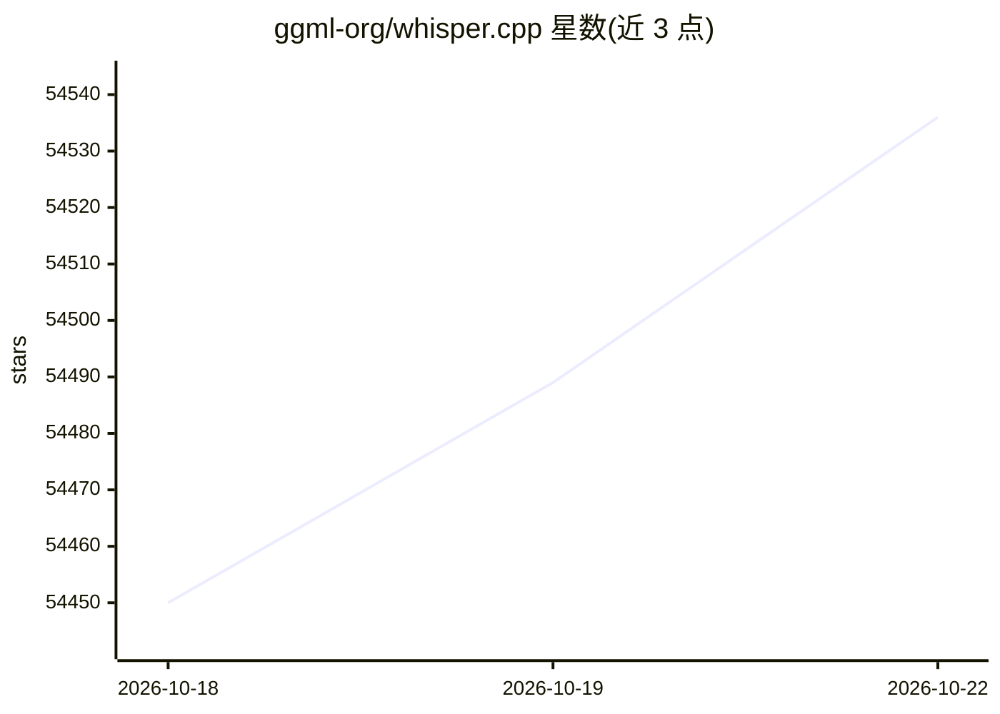

# ggml-org/whisper.cpp

⭐ 54,568 · C++ · MIT · 推送 2026-10-19 · [GitHub](https://github.com/ggml-org/whisper.cpp) · 组织维护

**在本地多平台离线运行 Whisper 语音识别的 C/C++ 推理实现**

OpenAI Whisper 语音识别模型的 C/C++ 移植，无依赖的纯 C/C++ 实现，基于 ggml 机器学习库构建。提供 C 风格 API、整数量化、VAD、混合精度推理，支持 Metal、Core ML、CUDA、Vulkan、OpenVINO 及 AMD NPU 等后端。模型需转换为 ggml 格式后由 whisper-cli 等示例程序运行，仅支持 16-bit WAV 输入，其他音频需用 ffmpeg 预先转换。支持 macOS/iOS/Android/Linux/Windows/WebAssembly 等平台，MIT 许可。

## 筛选速览

| 维度 | 判定 | 备注 |
|---|---|---|
| AI 角色 | `ai-ecosystem` | LLM/agent 周边工具 |
| 许可风险 | `permissive` | MIT |
| 部署形态 | `desktop` | 安装包/桌面程序 |
| 模型依赖 | local-ok | 支持本地模型 |
| 硬件要求 | `cpu-ok` | |
| 安装摩擦 | `high` | 编译与系统依赖俱全 |
| 成熟度 | — | 结构信号不足 |

## 动量与使用信号

- 维护:`active` — 距上次 push 6.1 天,年发版 15,445 位贡献者
- 涨星:近 1 天 **+21**(自 20261016 起算)
- 安装:pypi 包 `ane_transformers` 月下载 2,151
- 平台:WINDOWS / MACOS / LINUX / ANDROID / IOS · 协议:—

## 能力要点

- 纯 C/C++ 无依赖实现，基于 ggml 库，提供 C 风格 API
- 多后端支持：Metal、Core ML、ANE、CUDA、Vulkan、OpenVINO、AMD NPU
- 整数量化降低模型内存与磁盘占用（tiny 75 MiB 至 large 2.9 GiB）
- 跨平台覆盖 iOS、Android、WebAssembly、树莓派、Docker 等

## 适用场景

- 在手机或嵌入式设备上完全离线运行语音转文字
- 搭建本地离线语音助手应用
- 在 Apple Silicon 或 NVIDIA GPU 上加速语音识别推理

## 场景标签

`语音识别` `推理引擎` · 领域:感知与多模态

## 证据(README 行号)

> L11: High-performance inference of OpenAI's Whisper automatic speech recognition (ASR) model:
> L13: - Plain C/C++ implementation without dependencies
> L26: Supported platforms:

## 星数曲线

2026-10-18 54,450 → 2026-10-22 54,536（+86）

---
*卡片 v1 · prompt 1.4 · 生成 2026-10-18 · 置信度 mid · 依据 README sha `365030d96bb6` · [字段定义](../../DATASET.md)*
