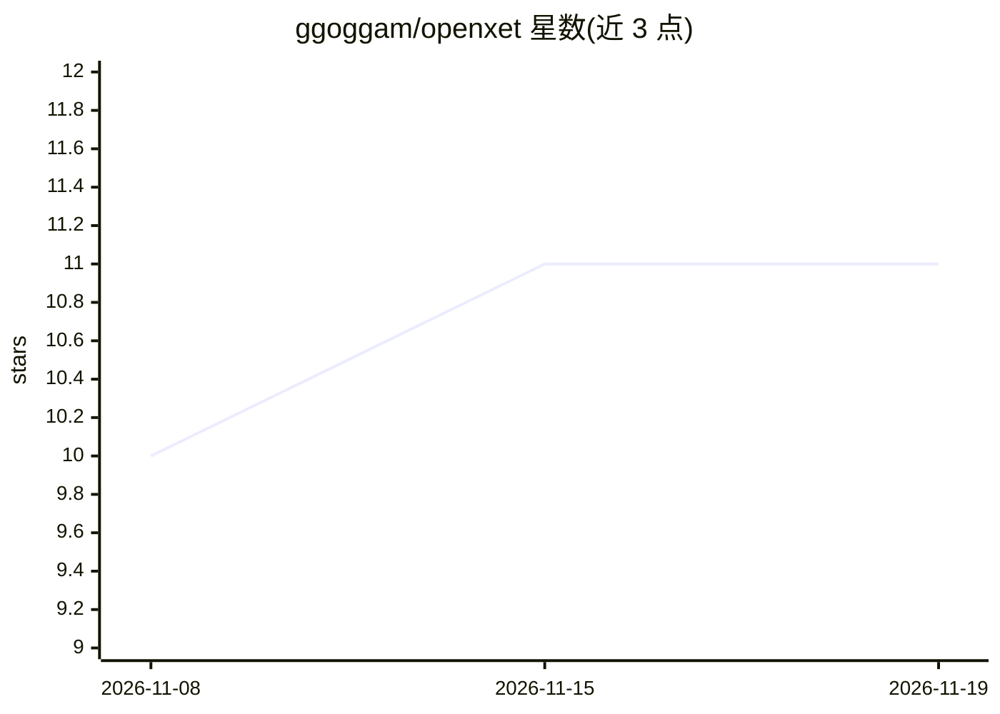

# ggoggam/openxet

⭐ 11 · Rust · Apache-2.0 · 推送 2026-10-26 · [GitHub](https://github.com/ggoggam/openxet) · 个人维护

**兼容 Xet 协议的 Rust 内容寻址存储（CAS）服务器，服务 HF xet 客户端**

用 Rust 实现的 Xet 协议 v1.0.0 兼容 CAS 服务器，复用 HuggingFace xet-core crates 保证二进制格式与 /v1 线协议一致，hf_xet/xet-core 客户端无需修改即可对接。核心机制包括 Gearhash CDC 分块、Blake3 内容寻址、块级全局去重、所有权 claim 记账与标记清除式 GC；支持文件系统与 S3（RustFS）两种存储后端、SQLite/Postgres 索引后端、OIDC 鉴权；附带 React Web UI（浏览器端 WASM 上传管道、DuckDB WASM 查询）。从源码构建（Rust/bun/wasm-pack），也提供 Docker Compose 部署。

## 筛选速览

| 维度 | 判定 | 备注 |
|---|---|---|
| AI 角色 | `ai-ecosystem` | LLM/agent 周边工具 |
| 许可风险 | `permissive` | Apache-2.0 |
| 部署形态 | `self-host` | docker 或自建部署 |
| 模型依赖 | — | README 未给出锁定关系 |
| 硬件要求 | — | 无带数字的原话,不猜 |
| 安装摩擦 | `low` | 无编译、无系统依赖或容器化 |
| 成熟度 | — | 结构信号不足 |

## 能力要点

- 兼容 Xet 协议 v1.0.0，直接复用 xet-core crates 保证线协议一致
- 块级去重：Gearhash CDC 分块 + Blake3 哈希 + xorb 归档
- 所有权 claim 记账、mark-and-sweep 垃圾回收与每所有者用量统计
- React Web UI 支持浏览器内分块上传与 CSV/Parquet 查询

## 适用场景

- 为 hf_xet/xet-core 客户端自建兼容的 CAS 存储后端
- 需要块级去重的大文件存储与多副本部署
- 本地或 S3 后端上托管内容寻址数据并带 Web 界面浏览

## 场景标签

 · 领域:存储基础设施/数据管理

## 证据(README 行号)

> L3: A Rust implementation of a Xet Protocol-compatible Content Addressable Storage (CAS) server with a browser upload pi
> L155: These are the same wire protocol endpoints HuggingFace's `xet-core` / `hf_xet`

## 星数曲线

2026-11-08 10 → 2026-11-19 11（+1）

---
*卡片 v1 · prompt 1.4 · 生成 2026-11-18 · 置信度 mid · 依据 README sha `54c9df543e8b` · [字段定义](../../DATASET.md)*
