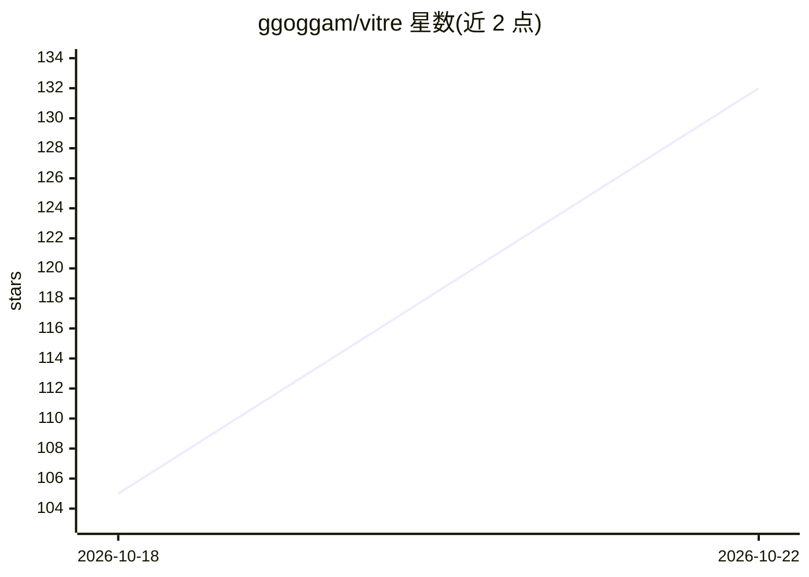

# ggoggam/vitre

⭐ 108 · Kotlin · MIT · 推送 2026-10-17 · [GitHub](https://github.com/ggoggam/vitre) · [官网](https://javadoc.io/doc/dev.ggoggam.vitre/vitre-core/latest/index.html) · 个人维护

**Kotlin 多平台 WebView 自动化库，可由 LLM agent 经 MCP/Koog 驱动**

面向 Kotlin Multiplatform 的嵌入式 WebView 自动化库：将页面操作描述为声明式步骤（导航、等待、点击、输入、提取、提取整表、快照、执行 JS、双向 postMessage、条件与遍历），一套代码运行于 Android、iOS 与桌面。同一词汇以四种方式提供：Kotlin DSL、Compose 组件、MCP 工具（vitre-mcp）与 Koog 工具（vitre-koog），后两者供 LLM agent 驱动页面。支持最多四车道的 WebView 池并行访问多个站点，含 cookie 读写（桌面端 cookie 尚返回 null）。Web 平台不在支持范围。发布于 Maven Central，亦可源码依赖。

## 筛选速览

| 维度 | 判定 | 备注 |
|---|---|---|
| AI 角色 | `ai-enhanced` | 去掉 AI 部分产品仍成立 |
| 许可风险 | `permissive` | MIT |
| 部署形态 | `None` |  |
| 模型依赖 | — | README 未给出锁定关系 |
| 硬件要求 | — | 无带数字的原话,不猜 |
| 安装摩擦 | `low` | 无编译、无系统依赖或容器化 |
| 成熟度 | — | 结构信号不足 |

## 能力要点

- 一套步骤词汇在 Android/iOS/桌面三平台运行，单一排序保证
- vitre-mcp 与 vitre-koog 将全部词汇暴露为 agent 工具，共用同一语义源
- 车道池支持最多四个站点并行，fan-out 带页屏障语义
- CSS/XPath/快照句柄三种元素寻址，双向 postMessage 带收件箱缓冲

## 适用场景

- 在应用内嵌 WebView 中读取、填表、抓取第三方页面数据
- 让 LLM agent 通过 MCP 或 Koog 工具驱动页面完成操作
- 混合应用通过 postMessage 桥与自有页面做类型化往返通信
- 在 Android/iOS/桌面测试中以同一 DSL 驱动页面流程

## 场景标签

`浏览器自动化` `网页抓取` · 领域:效率与自动化

## 证据(README 行号)

> L3: **WebView automation for Kotlin Multiplatform.** Describe what you want done to a page as a list of
> L20: drop into a screen, and, for an agent that has never seen the page, as MCP tools or as Koog tools.
> L57: - `vitre-mcp` exposes the whole vocabulary as MCP tools over an in-process transport, and

## 星数曲线

2026-10-18 105 → 2026-10-22 132（+27）

---
*卡片 v1 · prompt 1.4 · 生成 2026-10-22 · 置信度 high · 依据 README sha `6d2b6656d27f` · [字段定义](../../DATASET.md)*
