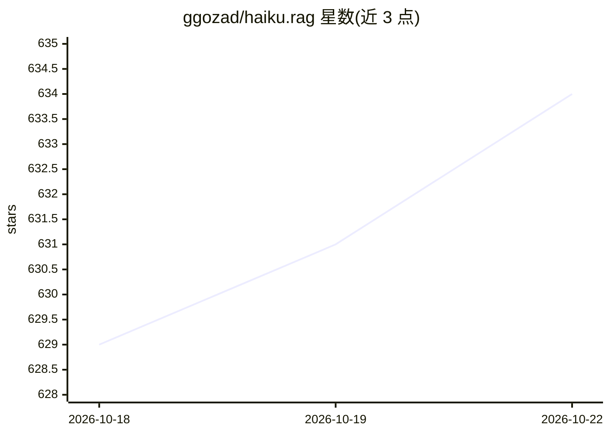

# ggozad/haiku.rag

⭐ 634 · Python · MIT · 推送 2026-10-22 · [GitHub](https://github.com/ggozad/haiku.rag) · [官网](https://ggozad.github.io/haiku.rag/) · 个人维护

**本地/自托管文档问答的 Agentic RAG 工具，带引用与来源核验**

基于嵌入式 LanceDB 的文档检索问答工具：用 Docling 解析 PDF/Office/HTML/Markdown/图片并保留页码与标题溯源，混合向量+全文检索可加重排，回答时运行沙箱 Python 做计数聚合并引用页码与章节，支持在页面图像上绘制引用块核验出处。默认通过 Ollama 使用开源模型，无需服务器或 API key，也可换用 Pydantic AI 支持的其他提供商。提供 CLI、TUI、Python API、MCP 服务器（Claude Code/Codex/Claude Desktop）、持续摄取服务与 Web 应用示例。

## 筛选速览

| 维度 | 判定 | 备注 |
|---|---|---|
| AI 角色 | `ai-native` | 本体是模型或模型工具 |
| 许可风险 | `permissive` | MIT |
| 部署形态 | `library` | 以包/库形式分发 |
| 模型依赖 | local-ok | 支持本地模型 |
| 硬件要求 | — | 无带数字的原话,不猜 |
| 安装摩擦 | `low` | 无编译、无系统依赖或容器化 |
| 成熟度 | — | 结构信号不足 |

## 能力要点

- Docling 解析多格式文档并保留页码/标题/表格/图片溯源
- 混合检索+可选重排（cross-encoder/Jina/Cohere/vLLM 等）
- 回答引用页码与标题，可在页面图像上绘制引用块核验
- 默认 Ollama 本地模型，无需服务器或 API key；提供 MCP 服务器与 ingester 服务

## 适用场景

- 本地知识库文档问答并核验答案出处
- 通过 MCP 接入 Claude Code/Codex 做文档检索
- 持续从文件系统/S3/WebDAV 摄取并索引文档

## 场景标签

`文档问答` `RAG` `文档解析` · 领域:知识与检索

## 证据(README 行号)

> L10: Agentic RAG that answers questions about your own documents with citations to page numbers and section headings. It
> L18: - **Answer** with the RAG capability: it searches, runs sandboxed Python over the documents for counting and aggreg

## 星数曲线

2026-10-18 629 → 2026-10-22 634（+5）

---
*卡片 v1 · prompt 1.4 · 生成 2026-10-21 · 置信度 high · 依据 README sha `eafce2f35a23` · [字段定义](../../DATASET.md)*
