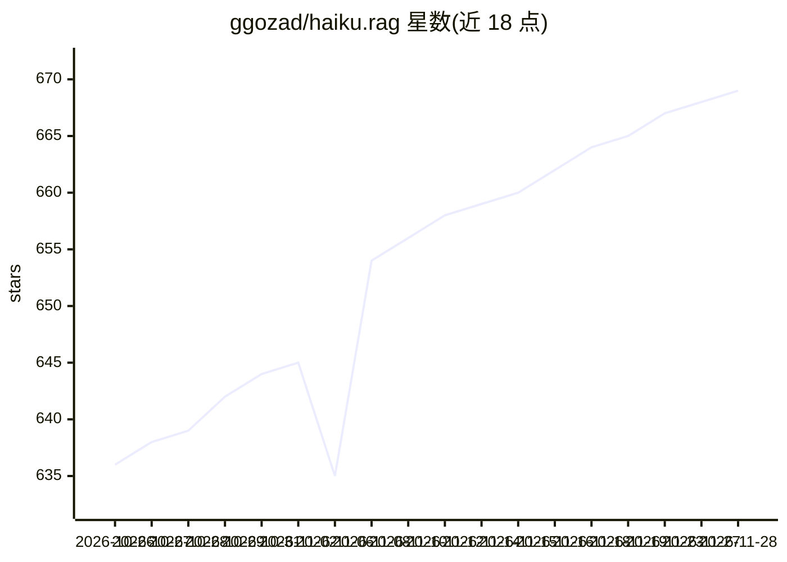

# ggozad/haiku.rag

⭐ 669 · Python · MIT · 推送 2026-11-27 · [GitHub](https://github.com/ggozad/haiku.rag) · [官网](https://ggozad.github.io/haiku.rag/) · 个人维护

**本地/自托管文档的 agentic RAG 问答库，带引用**

基于嵌入式 LanceDB 的开源 agentic RAG：用 Docling 解析 PDF、Office、HTML、Markdown 与图片，保留标题、表格与页码出处；支持向量+全文混合检索、可选重排与多模态嵌入；回答问题时可对文档运行沙箱 Python 做统计聚合，并给出页码与标题引用。默认通过 Ollama 使用开放模型，无需服务器或 API key；支持任意 Pydantic AI 兼容 provider，数据库可存于 S3/GCS/Azure/LanceDB Cloud。提供 CLI、TUI、Python API、MCP 服务器与参考 Web 应用。

## 筛选速览

| 维度 | 判定 | 备注 |
|---|---|---|
| AI 角色 | `ai-ecosystem` | LLM/agent 周边工具 |
| 许可风险 | `permissive` | MIT |
| 部署形态 | `library` | 以包/库形式分发 |
| 模型依赖 | local-ok | 支持本地模型 |
| 硬件要求 | — | 无带数字的原话,不猜 |
| 安装摩擦 | `low` | 无编译、无系统依赖或容器化 |
| 成熟度 | — | 结构信号不足 |

## 能力要点

- Docling 解析并保留 DoclingDocument 结构与页码出处
- 混合检索+可选重排（cross-encoder、Jina、Cohere 等）
- 回答时对文档运行沙箱 Python，回答必须声明 grounding
- 提供 MCP 服务器、插件钩子与 haiku-ingester 摄取服务

## 适用场景

- 对本地文档做带页码引用的问答
- 通过 MCP 让 Claude Code 等助手检索我的文档
- 用文件系统/HTTP/S3/WebDAV 源做持续摄取与索引

## 场景标签

`RAG` `文档问答` `文档解析` · 领域:知识与检索

## 证据(README 行号)

> L10: Open-source agentic RAG that answers questions about your own documents with citations to page numbers and section 
> L18: - **Answer** with the RAG capability: it searches, runs sandboxed Python over the documents for counting and aggreg
> L64: ```bash

## 星数曲线



2026-10-26 636 → 2026-11-28 669（+33）


---
*卡片 v1 · prompt 1.4 · 生成 2026-11-26 · 置信度 high · 依据 README sha `ffff19e33acf` · [字段定义](../../DATASET.md)*
