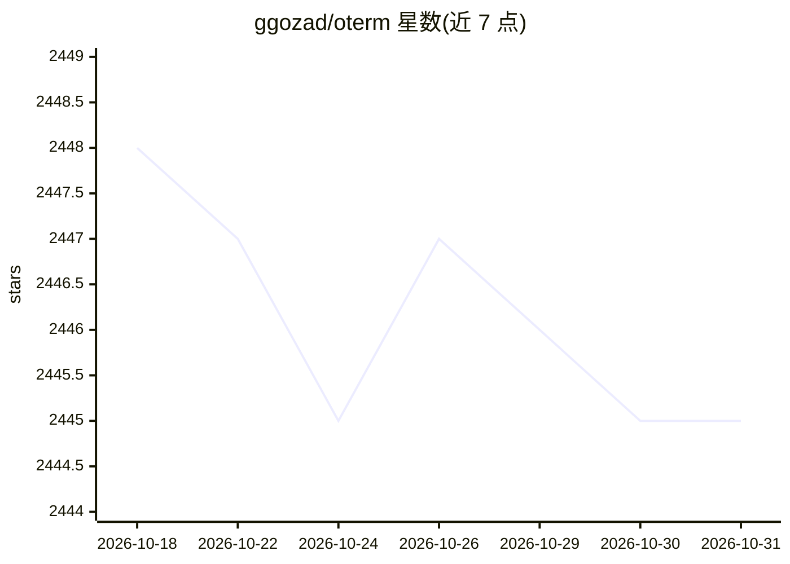

# ggozad/oterm

⭐ 2,445 · Python · MIT · 推送 2026-10-27 · [GitHub](https://github.com/ggozad/oterm) · [官网](https://ggozad.github.io/oterm/) · 个人维护

**终端里的 LLM 聊天客户端，接入多家模型服务**

基于 Textual 的终端 TUI 应用，作为 Ollama、OpenAI、Anthropic 及任何 pydantic-ai 支持的提供商的聊天客户端。通过 uvx oterm 一条命令即可运行，详细安装方法、配置与用法见其外部文档站，采用 MIT 许可证，由个人开发者维护。README 可见信息较简略，功能细节需查阅文档。

## 筛选速览

| 维度 | 判定 | 备注 |
|---|---|---|
| AI 角色 | `ai-ecosystem` | LLM/agent 周边工具 |
| 许可风险 | `permissive` | MIT |
| 部署形态 | `None` |  |
| 模型依赖 | local-ok | 支持本地模型 |
| 硬件要求 | — | 无带数字的原话,不猜 |
| 安装摩擦 | `low` | 无编译、无系统依赖或容器化 |
| 成熟度 | — | 结构信号不足 |

## 能力要点

- 支持 Ollama、OpenAI、Anthropic 及 pydantic-ai 兼容提供商
- 基于 Textual 的终端 TUI 界面
- uvx oterm 单命令运行

## 适用场景

- 在终端中直接与本地或云端 LLM 对话
- 统一客户端切换使用多家模型服务
- 偏好命令行环境的开发者日常使用

## 场景标签

`聊天机器人` · 领域:对话与助手

## 证据(README 行号)

> L6: The terminal client for Ollama, OpenAI, Anthropic, and any pydantic-ai-supported provider.
> L13: uvx oterm

## 星数曲线

2026-10-18 2,448 → 2026-10-31 2,445（-3）

---
*卡片 v1 · prompt 1.4 · 生成 2026-10-21 · 置信度 high · 依据 README sha `4da6f80ee7f6` · [字段定义](../../DATASET.md)*
