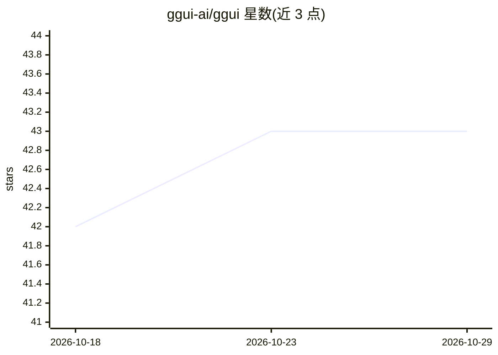

# ggui-ai/ggui

⭐ 43 · TypeScript · Apache-2.0 · 推送 2026-10-28 · [GitHub](https://github.com/ggui-ai/ggui) · [官网](https://ggui.ai) · 组织维护

**MCP-UI 协议与参考运行时：让 AI agent 按需生成可交互界面**

开源协议加参考运行时：agent 通过 MCP 工具（ggui_render/ggui_update/ggui_consume）描述所需界面，服务器生成临时可交互 UI 并经 WebSocket 推送到用户浏览器，用户操作回流给 agent。支持任意 MCP 感知的 agent 运行时（Claude Desktop、Cursor 等），提供 ggui CLI、蓝图与 gadget 模板机制、React/React Native 嵌入组件。组件生成需提供 ANTHROPIC_API_KEY 或 OPENAI_API_KEY；协议处于 pre-1.0 草案阶段，各包以 minor 波次同步发布。

## 筛选速览

| 维度 | 判定 | 备注 |
|---|---|---|
| AI 角色 | `ai-ecosystem` | LLM/agent 周边工具 |
| 许可风险 | `permissive` | Apache-2.0 |
| 部署形态 | `library` | 以包/库形式分发 |
| 模型依赖 | — | README 未给出锁定关系 |
| 硬件要求 | — | 无带数字的原话,不猜 |
| 安装摩擦 | `low` | 无编译、无系统依赖或容器化 |
| 成熟度 | `idea` | |

## 能力要点

- agent 经 MCP 工具描述需求，运行时生成临时可交互 UI 并回传用户事件
- ggui CLI 覆盖 serve/dev/blueprint/gadget/theme 五类工作流
- 提供 Web 与 React Native 嵌入组件及 iframe 直嵌方式
- 蓝图机制先匹配模板、未命中再回退 LLM 生成

## 适用场景

- 为我的 MCP agent 快速配上无需编写前端代码的交互界面
- 在聊天宿主（如 claude.ai）中让 agent 渲染富 UI 卡片
- 自托管 MCP-UI 服务器并配对现有 agent 运行时做端到端调试

## 场景标签

`Agent 框架` · 领域:Agent 开发

## 证据(README 行号)

> L3:  GGUI is the universal MCP-UI protocol — a runtime-negotiated data contract between AI agents and human users.
> L12: This repo is the **open protocol + reference runtime**. Self-host with `ggui serve`; pair against any MCP-aware age
> L139: Your agent uses MCP tools to push UIs and receive user events. The protocol is defined by `@ggui-ai/protocol`; the

## 星数曲线

2026-10-18 42 → 2026-10-29 43（+1）

---
*卡片 v1 · prompt 1.4 · 生成 2026-10-25 · 置信度 high · 依据 README sha `c02791835de5` · [字段定义](../../DATASET.md)*
