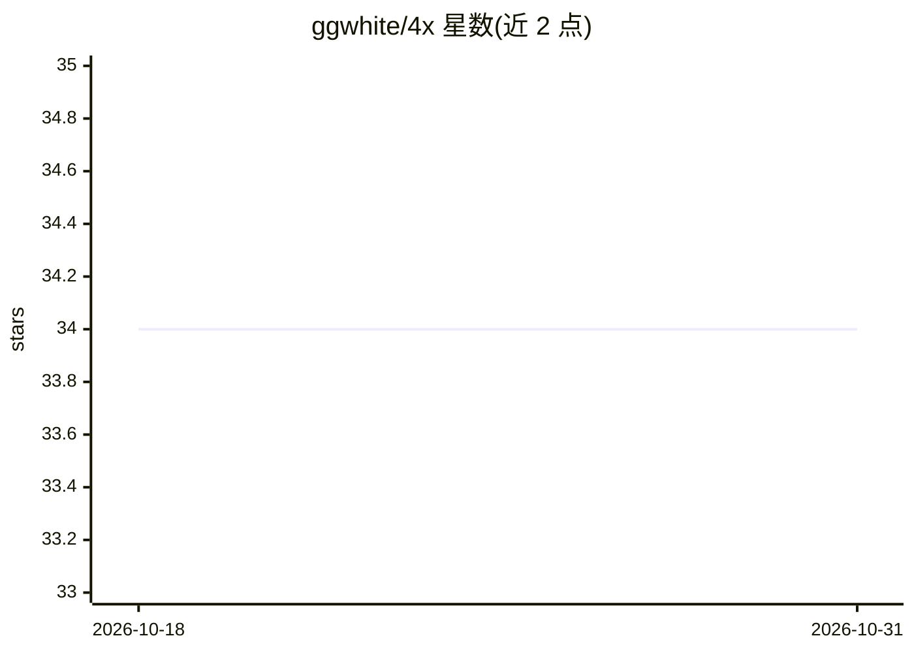

# ggwhite/4x

⭐ 34 · Go · MIT · 推送 2026-09-15 · [GitHub](https://github.com/ggwhite/4x) · [官网](https://ggwhite.github.io/4x/) · 个人维护 · 中文 README

**编排 AI 编码代理的多角色开发循环 CLI（设计/编码/审查/测试）**

Go 编写的开源 CLI，将 AI 编码代理组织为 Design→Code→Review→Test 隔离角色的开发循环。CLI 层不直接调用 LLM，由 Runner 桥接 6 种 AI 工具（Claude Code、Codex、Gemini CLI、Antigravity、Copilot、Cursor），通过统一的 .4x/ 文件协议混搭使用。确定性护栏（状态机、范围锁、基线快照、测试证据门）由 Go CLI 强制执行而非依赖提示词。附带 macOS/Windows/Linux 仪表盘、批量 DAG 调度、MCP server 与崩溃恢复。README 明示权衡：token 成本为单代理方式的 3-10 倍，不适合琐碎任务。

## 筛选速览

| 维度 | 判定 | 备注 |
|---|---|---|
| AI 角色 | `ai-ecosystem` | LLM/agent 周边工具 |
| 许可风险 | `permissive` | MIT |
| 部署形态 | `desktop` | 安装包/桌面程序 |
| 模型依赖 | locked-api |  |
| 硬件要求 | — | 无带数字的原话,不猜 |
| 安装摩擦 | `low` | 无编译、无系统依赖或容器化 |
| 成熟度 | — | 结构信号不足 |

## 能力要点

- 四角色隔离循环，Reviewer 对抗式设计，人工审查门
- 6 种 AI Runner 通过统一 .4x/ 文件协议混搭，无厂商锁定
- 确定性护栏由 Go CLI 强制执行（范围锁/状态机/基线快照/证据门）
- 依赖感知批量调度与崩溃自动恢复

## 适用场景

- 对正确性敏感的功能（支付、鉴权、数据管道）需要多角色 AI 开发流程
- 安全敏感代码需要对抗式审查与审计记录
- 批量排队功能需求，过夜执行后早晨统一人工审查

## 场景标签

`多智能体` `编码 Agent` `代码审查` · 领域:Agent 开发

## 证据(README 行号)

> L12: **4x** is an open-source CLI that orchestrates AI coding agents into a multi-role development loop — each role (Des
> L82: **Layer 1 — CLI** handles everything deterministic: scope validation, state transitions, baseline snapshots, eviden
> L236: **Q: Does 4x call any LLM APIs directly?**

## 星数曲线

2026-10-18 34 → 2026-10-31 34（+0）

---
*卡片 v1 · prompt 1.4 · 生成 2026-10-25 · 置信度 mid · 依据 README sha `f321b1a07ac7` · [字段定义](../../DATASET.md)*
