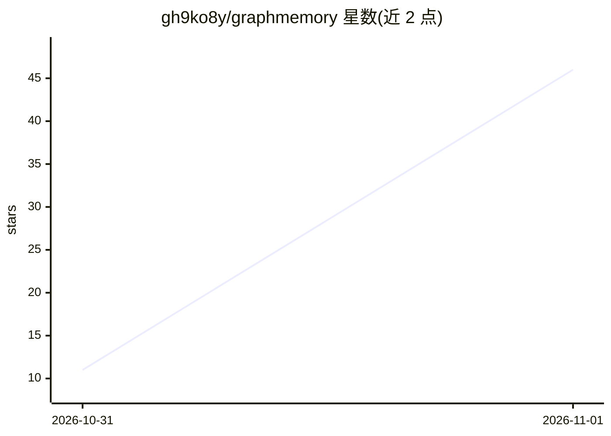

# gh9ko8y/graphmemory

⭐ 46 · Python · MIT · 推送 2026-10-30 · [GitHub](https://github.com/gh9ko8y/graphmemory) · 个人维护 · 中文 README

**给 AI 代理提供双时态长期记忆服务：会积累也会遗忘**

面向 AI 代理的长期记忆服务：每条事实带有效时间与记录时间双时间轴，采用 S/D/R/E/C/I 六变量重要性衰减模型，按内容分类自动设置 TTL（1 天至永久），到期先隐藏后物理删除但原文账本永久保留。检索层做激活×匹配×资源适配的竞争式 Top-K，命中会巩固记忆；支持语义去重与墓碑式遗忘。底层依赖 Graphiti 时序知识图谱 + PostgreSQL/pgvector + Redis。提供 FastAPI REST API、Web 管理台、内置 MCP server（11 个工具），任何支持 MCP 的代理可直接接入。安装需 Python ≥3.10 与 Docker Compose 启动数据库，Embedding 与事实抽取 LLM 走任意 OpenAI 兼容接口。

## 筛选速览

| 维度 | 判定 | 备注 |
|---|---|---|
| AI 角色 | `ai-ecosystem` | LLM/agent 周边工具 |
| 许可风险 | `permissive` | MIT |
| 部署形态 | `self-host` | docker 或自建部署 |
| 模型依赖 | — | README 未给出锁定关系 |
| 硬件要求 | — | 无带数字的原话,不猜 |
| 安装摩擦 | `low` | 无编译、无系统依赖或容器化 |
| 成熟度 | — | 结构信号不足 |

## 能力要点

- 双时态事实台账：能回答「当时是什么」和「后来改了什么」
- 六变量衰减模型 + 按内容分类的 TTL 时效（1 天至永久分档）
- 竞争式检索（激活×匹配×资源适配→θ 相对阈值→Top-K），命中巩固记忆
- 内置 MCP server（add_memory/search_memory/memory_dedupe 等 11 个工具）与 Web 管理台

## 适用场景

- 给我的 AI 代理接一个会积累、会随时间淡忘的长期记忆库
- 让代理记住用户偏好与身份信息并按时间口径回溯变更
- 通过 MCP 或 REST API 做语义去重和墓碑式遗忘管理

## 场景标签

`Agent 记忆` · 领域:Agent 开发

## 证据(README 行号)

> L3: **双时态 AI 记忆系统** — 给 AI 代理一个会积累、会遗忘、会随时间变化的长期记忆库。
> L32: |**MCP 工具**|内置 MCP server，任何支持 MCP 的代理都能直接调用|
> L39:    Agent / MCP 客户端 │  graphmemory (FastAPI :8000) │

## 星数曲线

2026-10-31 11 → 2026-11-01 46（+35）

---
*卡片 v1 · prompt 1.4 · 生成 2026-10-31 · 置信度 high · 依据 README sha `f32627c4ff19` · [字段定义](../../DATASET.md)*
