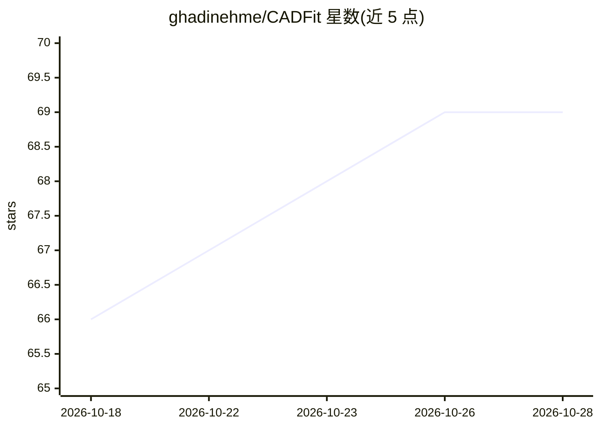

# ghadinehme/CADFit

⭐ 69 · Python · NOASSERTION · 推送 2026-09-28 · [GitHub](https://github.com/ghadinehme/CADFit) · [官网](https://ghadinehme.github.io/cadfit.github.io/) · 组织维护

**从水密网格恢复可编辑 CAD 程序的混合优化框架（ICML 2026 论文官方代码）**

MIT 与 Siemens 合作的论文官方代码库。CADFit 将网格重建 CAD 构造序列问题表述为对可执行 CAD 程序的 IoU 驱动优化：通过 CadQuery 内核逐步拟合与验证参数化操作（拉伸/旋转/圆角/倒角/布尔并/差），并做迭代残差修正与向后剪枝，输出重建 STL、等价 CadQuery Python 脚本与 IoU 报告。网格来源不限（STL、点云、图像转 3D，示例搭配 Hunyuan3D），无需重训练。以 conda+pip 源码方式运行，许可证为 CC BY-NC 4.0（限非商业/学术用途）。

## 筛选速览

| 维度 | 判定 | 备注 |
|---|---|---|
| AI 角色 | `ai-native` | 本体是模型或模型工具 |
| 许可风险 | `none` | NOASSERTION |
| 部署形态 | `library` | 以包/库形式分发 |
| 模型依赖 | — | README 未给出锁定关系 |
| 硬件要求 | — | 无带数字的原话,不猜 |
| 安装摩擦 | `low` | 无编译、无系统依赖或容器化 |
| 成熟度 | — | 结构信号不足 |

## 动量与使用信号

- 安装:github 包 `release-assets` 月下载无数据

## 能力要点

- IoU 驱动的可执行 CAD 程序优化，CadQuery 内核验证，基准切片 Invalid Ratio 为 0
- 算子集覆盖 Extrude/Revolve/Fillet/Chamfer/Union/Cut
- 模态无关：同一算法处理 STL、点云、图像转 3D 网格，无需重训练
- 输出等价 CadQuery Python 脚本，可直接编辑复现实体

## 适用场景

- 把 STL 网格反推为可编辑的参数化 CAD 程序
- 结合图像转 3D 模型搭建端到端 image-to-CAD 流程
- 为下游学习模型生成更紧凑的 CAD 程序监督数据

## 场景标签

 · 领域:三维几何/CAD 逆向工程

## 证据(README 行号)

> L11: **CADFit** is a hybrid optimization-based framework that recovers complex, editable CAD construction sequences from
> L27: CADFit is agnostic to where the mesh comes from. Pairing it with a pretrained image-to-3D model — we use Hunyuan3D 
> L33: ## Quick Start

## 星数曲线

2026-10-18 66 → 2026-10-28 69（+3）

---
*卡片 v1 · prompt 1.4 · 生成 2026-10-18 · 置信度 high · 依据 README sha `446ae09a55e1` · [字段定义](../../DATASET.md)*
