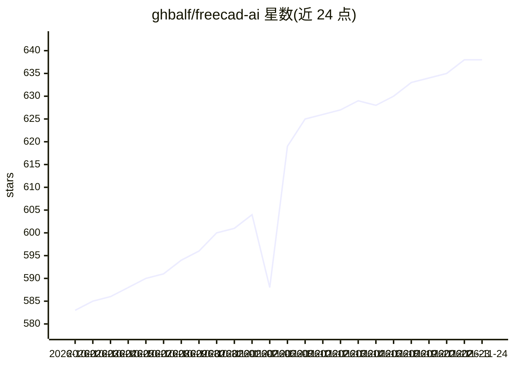

# ghbalf/freecad-ai

⭐ 638 · Python · LGPL-2.1 · 推送 2026-11-20 · [GitHub](https://github.com/ghbalf/freecad-ai) · 个人维护

**FreeCAD 的 AI 助手工作台：自然语言生成 3D 模型**

以 FreeCAD 工作台（workbench）形式安装的 AI 助手插件，将自然语言描述转换为并执行 Python 代码以生成 3D 模型。提供流式聊天界面、Plan/Act 两种执行模式、50 个结构化 FreeCAD 工具调用、可复用技能与技能优化器、错误自动重试（最多 3 次）等功能。支持 27 个 LLM 提供商（含本地 Ollama 与各云服务 API），零外部 Python 依赖（仅用标准库）。安装方式为将仓库链接/复制到 FreeCAD 的 Mod 目录；要求 FreeCAD 1.0+ 与一个 LLM 提供商（本地 Ollama 或云端 API key）。

## 筛选速览

| 维度 | 判定 | 备注 |
|---|---|---|
| AI 角色 | `ai-native` | 本体是模型或模型工具 |
| 许可风险 | `viral` | LGPL-2.1 |
| 部署形态 | `desktop` | 安装包/桌面程序 |
| 模型依赖 | local-ok | 支持本地模型 |
| 硬件要求 | — | 无带数字的原话,不猜 |
| 安装摩擦 | `low` | 无编译、无系统依赖或容器化 |
| 成熟度 | `idea` | |

## 动量与使用信号

- 安装:github 包 `release-assets` 月下载无数据

## 能力要点

- 自然语言生成并执行 Python 代码创建 3D 模型
- Plan/Act 双模式：执行前审阅或自动执行
- 50 个结构化工具调用与错误自动重试
- 支持 27 个 LLM 提供商，含本地 Ollama

## 适用场景

- 在 FreeCAD 中用对话描述生成 3D 零件模型
- 本地 Ollama 模型离线驱动 CAD 建模
- 通过技能（skills）复用封装件、齿轮等建模指令集

## 场景标签

`编码 Agent` · 领域:编码与开发

## 证据(README 行号)

> L5: An AI-powered assistant workbench for FreeCAD that generates and executes Python code to create 3D models from natur
> L24: - **27 LLM providers** — Anthropic, OpenAI, Ollama, Gemini, OpenRouter, Requesty, Opper, Cloudflare Workers AI, Moo
> L34: - FreeCAD 1.0+ (tested with 1.0.2 and 1.1.0)

## 星数曲线

2026-10-22 583 → 2026-11-24 638（+55）

---
*卡片 v1 · prompt 1.4 · 生成 2026-11-24 · 置信度 high · 依据 README sha `91baf0e95465` · [字段定义](../../DATASET.md)*
