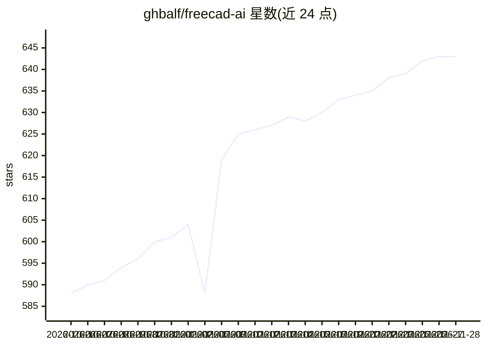

# ghbalf/freecad-ai

⭐ 643 · Python · LGPL-2.1 · 推送 2026-11-27 · [GitHub](https://github.com/ghbalf/freecad-ai) · 个人维护

**FreeCAD 插件：用自然语言生成并执行代码创建 3D 模型**

以 FreeCAD Workbench 形式安装的 AI 助手插件，将自然语言描述转为 Python 代码并在 FreeCAD 中执行以生成 3D 模型。提供聊天面板、Plan/Act 两种执行模式（先审代码或自动执行）、50 个结构化工具调用、错误自纠错重试、技能系统与优化器、MCP 服务器接入、会话保存恢复等机制。支持 27 家 LLM 提供商（含本地 Ollama），仅依赖 Python 标准库。要求 FreeCAD 1.0+ 与一个 LLM 提供商；README 声明处于 Alpha 阶段，主要在 Linux 上开发测试。

## 筛选速览

| 维度 | 判定 | 备注 |
|---|---|---|
| AI 角色 | `ai-native` | 本体是模型或模型工具 |
| 许可风险 | `viral` | LGPL-2.1 |
| 部署形态 | `desktop` | 安装包/桌面程序 |
| 模型依赖 | local-ok | 支持本地模型 |
| 硬件要求 | — | 无带数字的原话,不猜 |
| 安装摩擦 | `low` | 无编译、无系统依赖或容器化 |
| 成熟度 | `idea` | |

## 动量与使用信号

- 安装:github 包 `release-assets` 月下载无数据

## 能力要点

- Plan/Act 双模式与 50 个结构化 FreeCAD 工具调用
- 错误自纠错：失败代码回传 LLM 自动重试（最多 3 次）
- 27 家 LLM 提供商接入，含本地 Ollama 与任意 OpenAI 兼容端点
- MCP 服务器、用户自定义 Python 工具与技能系统

## 适用场景

- 在 FreeCAD 中用对话描述直接生成 3D 模型
- 本地 Ollama 离线环境下做参数化建模
- 通过技能与自定义工具扩展专属建模流程

## 场景标签

`代码生成` · 领域:编码与开发

## 证据(README 行号)

> L5: An AI-powered assistant workbench for FreeCAD that generates and executes Python code to create 3D models from natur
> L24: - **27 LLM providers** — Anthropic, OpenAI, Ollama, Gemini, OpenRouter, Requesty, Opper, Cloudflare Workers AI, Moo
> L34: - FreeCAD 1.0+ (integration tests pass on 1.0.1, 1.0.2, 1.1.1, 1.1.4 and the 26.3 release candidate; day-to-day GUI

## 星数曲线

2026-10-26 588 → 2026-11-28 643（+55）

---
*卡片 v1 · prompt 1.4 · 生成 2026-11-25 · 置信度 high · 依据 README sha `06a23727ec69` · [字段定义](../../DATASET.md)*
