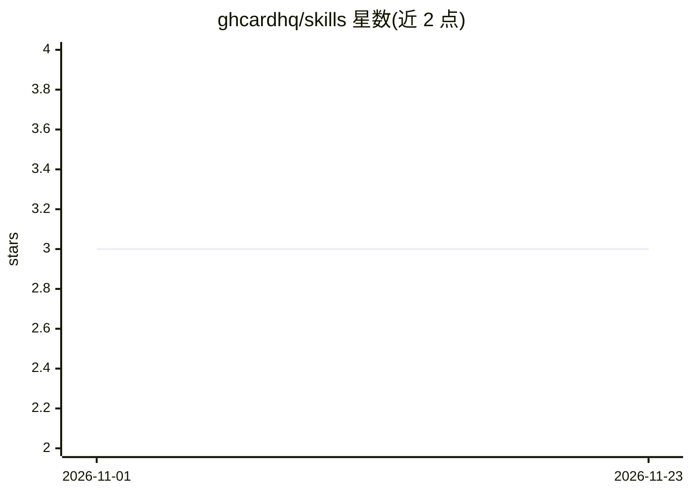

# ghcardhq/skills

⭐ 3 · MIT · 推送 2026-11-08 · [GitHub](https://github.com/ghcardhq/skills) · [官网](https://githubcard.com) · 组织维护

**为 Claude Code 用户提供 GitHub 个人页/仓库卡片生成技能**

GitHubCard 发布的 Claude Code 插件市场包，内含 Skill（SKILL.md 指引卡片制作、布局编辑、README 放置与错误码处理）与本地 stdio MCP 服务器两部分，通过驱动 ghcard CLI 生成 GitHub 个人资料卡与仓库卡并插入 README、链接预览和社交帖子。可选配置 GitHubCard API key（免费申请），无 key 时仍可浏览模板与调色板，仅建卡需要 key；也支持复制 skills 目录供其他 agent 使用。

## 筛选速览

| 维度 | 判定 | 备注 |
|---|---|---|
| AI 角色 | `ai-ecosystem` | LLM/agent 周边工具 |
| 许可风险 | `permissive` | MIT |
| 部署形态 | `None` |  |
| 模型依赖 | — | README 未给出锁定关系 |
| 硬件要求 | — | 无带数字的原话,不猜 |
| 安装摩擦 | `low` | 无编译、无系统依赖或容器化 |
| 成熟度 | — | 结构信号不足 |

## 能力要点

- Skill（SKILL.md）+ MCP server 双形态，驱动 ghcard CLI
- 支持 Claude Code 插件市场一键安装或手动复制技能目录
- 无 API key 可浏览模板/调色板，建卡才需要 key
- 提供 Cursor/VS Code/Windsurf/Codex 等客户端的 MCP 配置指引

## 适用场景

- 为个人 GitHub 主页 README 顶部生成资料卡片
- 为开源项目 README 添加仓库卡片
- 在其他支持 Agent Skills 的 agent 中复用该技能目录

## 场景标签

 · 领域:开发工具/README 美化

## 证据(README 行号)

> L9: A Claude Code plugin marketplace from GitHubCard. The
> L15: - **Skill** (`skills/githubcard/SKILL.md`): when and how to make a card, how to
> L19: - **MCP server**: a local stdio server from `@ghcardhq/ghcard`, so Claude can

## 星数曲线

2026-11-01 3 → 2026-11-23 3（+0）

---
*卡片 v1 · prompt 1.4 · 生成 2026-11-22 · 置信度 high · 依据 README sha `19cacbbe124b` · [字段定义](../../DATASET.md)*
