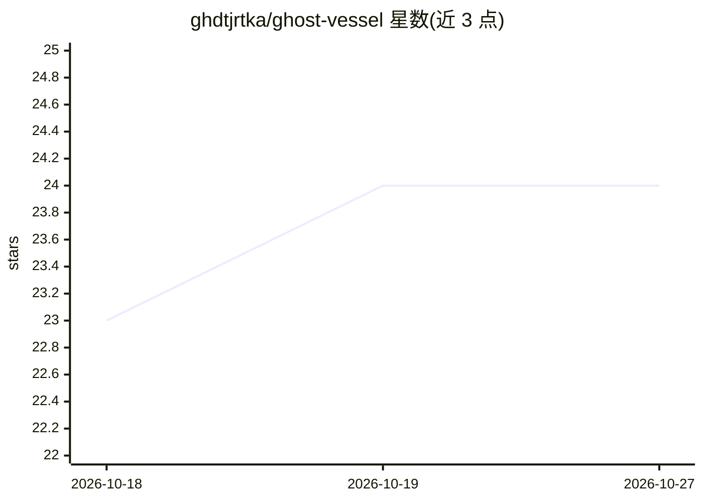

# ghdtjrtka/ghost-vessel

⭐ 24 · JavaScript · MIT · 推送 2026-07-26 · [GitHub](https://github.com/ghdtjrtka/ghost-vessel) · 个人维护

**为本地 LLM agent 提供视频通话式虚拟形象前端**

一个桌面常驻的视频通话风格虚拟形象界面，作为 Hermes/OpenClaw 等本地 agent 的客户端：替换 Telegram 等聊天窗口，并在头像窗口内呈现该 agent 的实时斜杠命令菜单（如 Hermes 的 52 条命令）。回复按动作/台词/数据三面拆分，动作驱动预渲染表情片段与情绪/好感度追踪，运行时无需 GPU 推理。TTS 支持本地（Qwen3-TTS/MeloTTS/Piper）与云端引擎，附带头像制作工具链。引擎 MIT 开源，附赠 2D 起始头像，写实头像与 Windows 安装包另行付费。

## 筛选速览

| 维度 | 判定 | 备注 |
|---|---|---|
| AI 角色 | `ai-ecosystem` | LLM/agent 周边工具 |
| 许可风险 | `permissive` | MIT |
| 部署形态 | `None` |  |
| 模型依赖 | — | README 未给出锁定关系 |
| 硬件要求 | — | 无带数字的原话,不猜 |
| 安装摩擦 | `low` | 无编译、无系统依赖或容器化 |
| 成熟度 | — | 结构信号不足 |

## 能力要点

- 呈现 agent 的实时斜杠命令菜单，命令直传 agent
- 3 面输出：表情动作/本地 TTS 台词/代码与文件卡片
- 预渲染片段驱动表情与情绪/好感度系统，运行时无 GPU 推理
- 附带头像制作工具链（剪辑分段、无缝待机循环、校验脚本）

## 适用场景

- 给本地 Hermes/OpenClaw agent 换一个有表情的头像交互界面
- 用自己的图像生成视频模型制作自定义形象
- 代替常开的 Telegram 聊天窗口控制 agent

## 场景标签

`聊天机器人` · 领域:对话与助手

## 证据(README 行号)

> L4: > A monitor-resident, video-call-style avatar that **fronts your personal AI agent**
> L47: - **Agent-agnostic**: Hermes (relay connector contract, WS server) and OpenClaw
> L50: - **The messenger's menu, in the avatar**: type `/` and the chat pulls your agent's

## 星数曲线

2026-10-18 23 → 2026-10-27 24（+1）

---
*卡片 v1 · prompt 1.4 · 生成 2026-10-27 · 置信度 high · 依据 README sha `df0c18876e19` · [字段定义](../../DATASET.md)*
