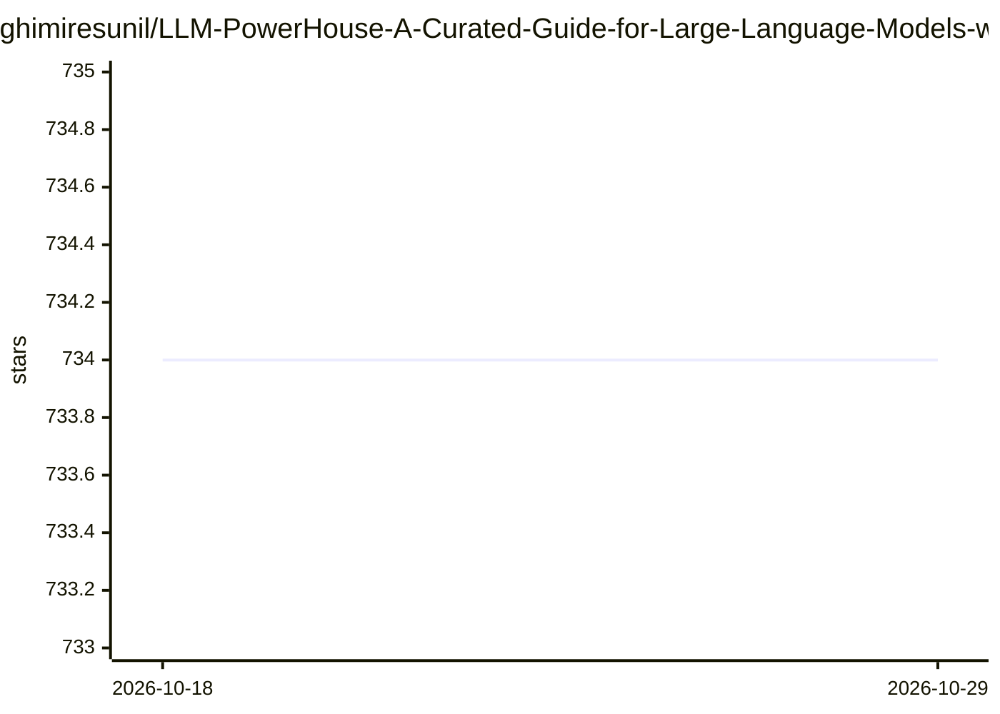

# ghimiresunil/LLM-PowerHouse-A-Curated-Guide-for-Large-Language-Models-with-Custom-Training-and-Inferencing

⭐ 734 · Jupyter Notebook · MIT · 推送 2026-03-13 · [GitHub](https://github.com/ghimiresunil/LLM-PowerHouse-A-Curated-Guide-for-Large-Language-Models-with-Custom-Training-and-Inferencing) · 个人维护

**LLM 训练与推理的策展教程清单：含代码示例与数据集**

面向开发者、研究者和爱好者的 LLM 学习资源汇总仓库：按目标组织内容，涵盖 LLM 基础（数学、Python、神经网络、NLP）、LLM 科学（架构、指令数据集构建等）、生产级应用构建（RAG、部署、安全）等章节；每个主题以概念表加外部参考链接（3Blue1Brown、Khan Academy、Fast.ai 等）形式呈现，仓库内还包含示例代码库与数据集集合。内容为教程与资源清单，不提供可直接安装运行的软件包。

## 筛选速览

| 维度 | 判定 | 备注 |
|---|---|---|
| AI 角色 | `ai-knowledge` | 知识聚合/清单类 |
| 许可风险 | `permissive` | MIT |
| 部署形态 | `None` |  |
| 模型依赖 | — | README 未给出锁定关系 |
| 硬件要求 | — | 无带数字的原话,不猜 |
| 安装摩擦 | `low` | 无编译、无系统依赖或容器化 |
| 成熟度 | — | 结构信号不足 |

## 能力要点

- 按学习目标（基础/训练对齐/生产应用/示例/数据集）组织的导航结构
- 各主题以概念表加外部参考资源链接的策展形式呈现
- 仓库含示例代码库（Codebase Mastery）与 LLM 数据集集合

## 适用场景

- 系统学习从数学基础到 LLM 架构与训练的完整路径
- 查找指令数据集构建与微调相关的方法和参考
- 为生产级 LLM 应用（RAG、部署、安全）查找指南与示例代码

## 场景标签

`精选清单` `教程课程` · 领域:学习与行业

## 证据(README 行号)

> L6: Welcome to LLM-PowerHouse, your ultimate resource for unleashing the full potential of Large Language Models (LLMs) 
> L18: ## Repository map

## 星数曲线

2026-10-18 734 → 2026-10-29 734（+0）

---
*卡片 v1 · prompt 1.4 · 生成 2026-10-21 · 置信度 high · 依据 README sha `3ee512969ffd` · [字段定义](../../DATASET.md)*
