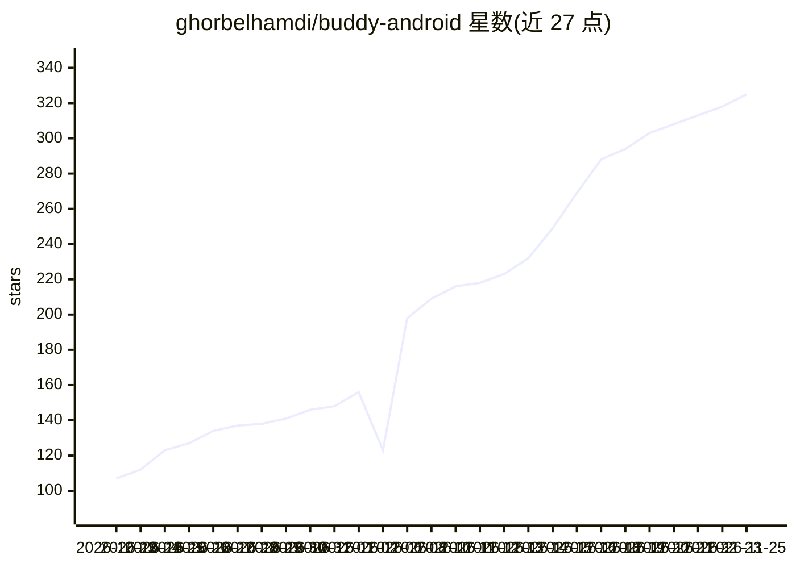

# ghorbelhamdi/buddy-android

⭐ 325 · Java · Apache-2.0 · 推送 2026-11-23 · [GitHub](https://github.com/ghorbelhamdi/buddy-android) · [官网](https://ghorbelhamdi.github.io/buddy-android/) · 个人维护

**悬浮气泡里让编码 agent 替你操作 Android 手机的助手应用**

Android 悬浮聊天气泡应用，内嵌 Claude Code、Codex、OpenCode、Antigravity CLI、Grok 等 agent，通过无障碍服务读取屏幕并代为点击、输入，完成回消息、购物、智能家居等任务；发送/支付/删除前需用户批准。架构为应用内 Alpine Linux（proot）运行 agent CLI，经本地 MCP 服务器调用手机工具。使用用户自有账号额度，无需 API key、root、adb 或电脑；亦支持在手机 NPU 上离线运行 Gemma/Qwen 模型。要求 64 位 Android 11+。

## 筛选速览

| 维度 | 判定 | 备注 |
|---|---|---|
| AI 角色 | `ai-native` | 本体是模型或模型工具 |
| 许可风险 | `permissive` | Apache-2.0 |
| 部署形态 | `None` |  |
| 模型依赖 | local-ok | 支持本地模型 |
| 硬件要求 | — | 无带数字的原话,不猜 |
| 安装摩擦 | `medium` | 含编译或系统依赖之一 |
| 成熟度 | `idea` | |

## 能力要点

- 无障碍服务 + 本地 MCP 工具链：读屏、点击、输入、滚动、打开应用
- 后台模式与并行子 agent，各在独立隐藏屏幕工作
- 发送/支付/删除前强制批准，不输入密码
- 手机端 llama.cpp 离线模型（NPU/GPU/CPU），或连电脑端 Ollama/LM Studio

## 适用场景

- 用自然语言让 AI 代为回消息、购物、操作手机设置
- 不用电脑和 adb，在手机上运行 Claude Code 等 agent
- 离线场景用手机本地模型完成简单任务

## 场景标签

`GUI 自动化` `AI 助手` `编码 Agent` · 领域:效率与自动化

## 证据(README 行号)

> L13: **A floating chat bubble that lets Claude Code, Codex, OpenCode, Antigravity or Grok use your Android phone.**
> L59: Buddy is a normal Android app with an accessibility service, the kind of permission screen readers use. The agent r

## 星数曲线

2026-10-23 107 → 2026-11-25 325（+218）

---
*卡片 v1 · prompt 1.4 · 生成 2026-11-25 · 置信度 high · 依据 README sha `6ee3753e5aae` · [字段定义](../../DATASET.md)*
