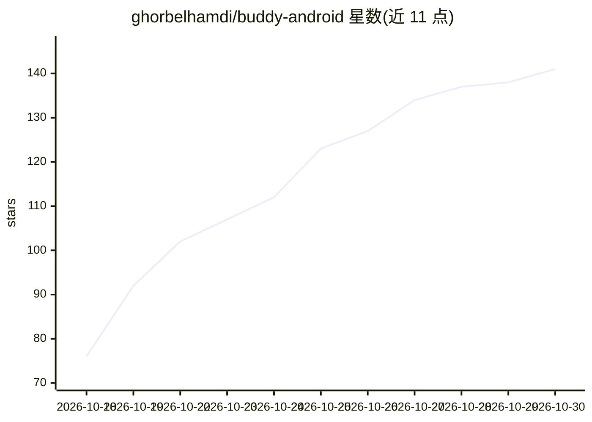

# ghorbelhamdi/buddy-android

⭐ 141 · Java · Apache-2.0 · 推送 2026-10-29 · [GitHub](https://github.com/ghorbelhamdi/buddy-android) · [官网](https://ghorbelhamdi.github.io/buddy-android/) · 个人维护

**让 Claude Code 等 AI agent 在安卓手机上操作应用的悬浮气泡应用**

Android 悬浮聊天气泡应用，让 Claude Code、Codex、OpenCode 或 Antigravity agent 在手机上代用户操作：读取屏幕、点击、输入，执行回复消息、购物、开灯等任务；发送/支付/删除等敏感操作前需用户批准。agent 运行在应用内置的 Alpine Linux（proot）中，通过本地 MCP 服务器（127.0.0.1）调用手机工具，无需 adb、root 或 PC，使用用户自有订阅或 OpenCode 免费模型。要求 64 位 Android 11+，通过 Google Play 或 APK 安装，Apache-2.0 许可，自述处于早期版本 2.2。

## 筛选速览

| 维度 | 判定 | 备注 |
|---|---|---|
| AI 角色 | `ai-native` | 本体是模型或模型工具 |
| 许可风险 | `permissive` | Apache-2.0 |
| 部署形态 | `None` |  |
| 模型依赖 | — | README 未给出锁定关系 |
| 硬件要求 | — | 无带数字的原话,不猜 |
| 安装摩擦 | `medium` | 含编译或系统依赖之一 |
| 成熟度 | `idea` | |

## 能力要点

- agent 经无障碍服务与本地 MCP 服务器实现屏幕读取、点击、输入等手机操作
- 敏感操作（发送/购买/删除）由 Buddy 强制用户批准，agent 不能自行执行
- 支持 Claude Code/Codex/OpenCode/Antigravity 多种 agent，用自有订阅或免费模型
- 无需 adb、root、PC，离线 Wi-Fi 场景也可工作

## 适用场景

- 用对话让 AI 代为回复消息、网购下单、控制智能家居
- 在手机上本地运行 Claude Code 等 CLI agent 并构建安装 APK
- 作为本地 MCP 服务器供自己的 agent 会话调用手机工具

## 场景标签

`GUI 自动化` `AI 助手` · 领域:效率与自动化

## 证据(README 行号)

> L11: **A floating chat bubble that lets Claude Code, Codex, OpenCode or Antigravity use your Android phone.**
> L13: Type or say what you want, like "reply to Sam that I'm running late" or "add a Switch 2 to my Amazon cart". Buddy r
> L51: Buddy is a normal Android app with an accessibility service, the kind of permission screen readers use. The agent r

## 星数曲线

2026-10-18 76 → 2026-10-30 141（+65）

---
*卡片 v1 · prompt 1.4 · 生成 2026-10-23 · 置信度 high · 依据 README sha `1be3e8e04ebf` · [字段定义](../../DATASET.md)*
