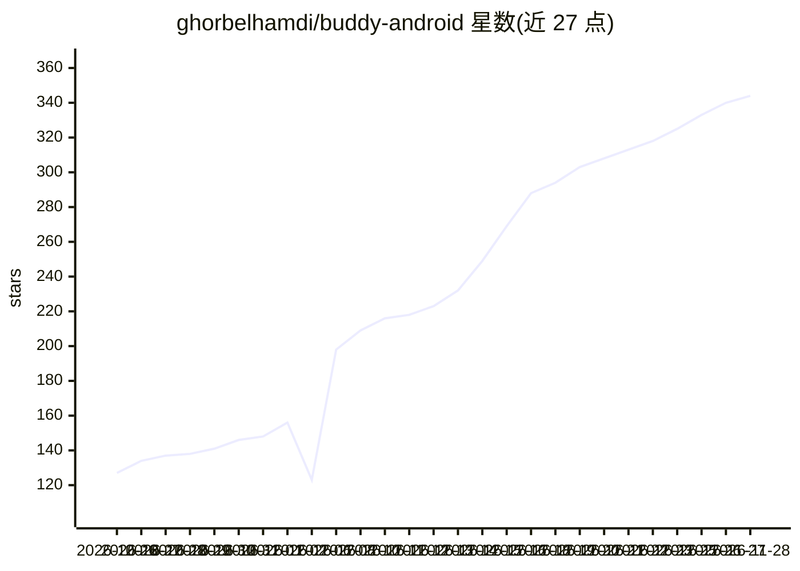

# ghorbelhamdi/buddy-android

⭐ 344 · Java · Apache-2.0 · 推送 2026-11-26 · [GitHub](https://github.com/ghorbelhamdi/buddy-android) · [官网](https://ghorbelhamdi.github.io/buddy-android/) · 个人维护

**Android 浮窗 AI 助手：让 agent 替你操作手机**

一个 Android 浮动聊天气泡应用，将 Claude Code、Codex、OpenCode、Antigravity CLI、Grok、Copilot、Pi 等 agent 接入手机：读取屏幕、点击、输入以完成用户指令，发送/购买/删除前先请求确认。agent 运行在应用内的 Alpine proot Linux 中，通过本地 MCP 服务器调用无障碍服务的手机工具。支持多 agent 协作聊天、后台隐藏屏执行、例程复用、应用内浏览器，以及通过 llama.cpp 在手机 NPU/GPU/CPU 上离线运行 Gemma/Qwen 模型。需 Android 11+ 64 位，无需 PC、adb 或 root；Google Play 拒绝其上架，通过 APK 或 F-Droid 分发。

## 筛选速览

| 维度 | 判定 | 备注 |
|---|---|---|
| AI 角色 | `ai-native` | 本体是模型或模型工具 |
| 许可风险 | `permissive` | Apache-2.0 |
| 部署形态 | `None` |  |
| 模型依赖 | local-ok | 支持本地模型 |
| 硬件要求 | — | 无带数字的原话,不猜 |
| 安装摩擦 | `medium` | 含编译或系统依赖之一 |
| 成熟度 | `idea` | |

## 能力要点

- 本地 MCP 服务器暴露读屏/点击/输入等手机工具给 agent
- 多 agent 团队协作（leader+workers、pipeline、doer+checker 模式）
- llama.cpp 在手机 NPU/GPU/CPU 离线运行 Gemma/Qwen，或连接 Ollama/LM Studio/llama.cpp 服务器
- 操作前强制确认（Send/Pay/Delete 类按钮硬限制），不输入密码

## 适用场景

- 用自然语言让 agent 代发消息、购物、操作智能家居
- 通知到达时按规则自动回复并经确认
- 无账号地用 OpenCode 免费模型离线驱动手机任务
- 在手机上直接让 agent 构建并安装 APK 应用

## 场景标签

`AI 助手` `GUI 自动化` `多智能体` `推理引擎` · 领域:Agent 开发

## 证据(README 行号)

> L13: **A floating chat bubble that lets Claude Code, Codex, OpenCode, Antigravity, Grok, Copilot or Pi use your Android 
> L15: Type or say what you want, like "reply to Sam that I'm running late" or "add a Switch 2 to my Amazon cart". Buddy r
> L67: Buddy is a normal Android app with an accessibility service, the kind of permission screen readers use. The agent r

## 星数曲线

2026-10-26 127 → 2026-11-28 344（+217）

---
*卡片 v1 · prompt 1.4 · 生成 2026-11-27 · 置信度 high · 依据 README sha `0697f858b9db` · [字段定义](../../DATASET.md)*
