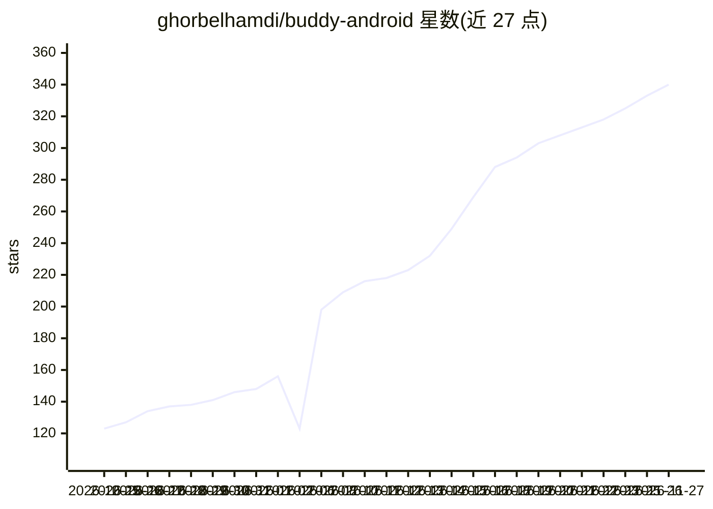

# ghorbelhamdi/buddy-android

⭐ 340 · Java · Apache-2.0 · 推送 2026-11-26 · [GitHub](https://github.com/ghorbelhamdi/buddy-android) · [官网](https://ghorbelhamdi.github.io/buddy-android/) · 个人维护

**Android 悬浮气泡 AI 助手：让 coding agent 代你操作手机**

一个 Android 悬浮聊天气泡应用，内嵌 Claude Code、Codex、OpenCode、Antigravity CLI、Grok Build、Copilot CLI 或 Pi 等 agent，通过无障碍服务读取屏幕、点击与输入，替用户完成发消息、购物、智能家居等任务；发送/支付/删除前强制弹出审批卡片。agent 运行于应用内 Alpine proot Linux 环境，经本地 MCP server 调用手机工具，无需 PC、adb、root 或 API key。支持多 agent 协作团队、后台隐藏屏幕模式、例程重放、内置浏览器与端上 llama.cpp 本地模型。安装走 APK 或 F-Droid，要求 64 位 Android 11+。

## 筛选速览

| 维度 | 判定 | 备注 |
|---|---|---|
| AI 角色 | `ai-native` | 本体是模型或模型工具 |
| 许可风险 | `permissive` | Apache-2.0 |
| 部署形态 | `None` |  |
| 模型依赖 | local-ok | 支持本地模型 |
| 硬件要求 | — | 无带数字的原话,不猜 |
| 安装摩擦 | `medium` | 含编译或系统依赖之一 |
| 成熟度 | `idea` | |

## 能力要点

- 无障碍服务实现读屏/点击/输入，本地 MCP server 暴露手机工具
- 多 agent 团队协作（leader+workers、pipeline、doer+checker）与后台隐藏屏幕
- 端上 llama.cpp 运行 Gemma/Qwen，支持 NPU/GPU/CPU 离线运行
- 内置 Alpine Linux（proot），可在手机上构建 APK 并安装

## 适用场景

- 用自然语言让 agent 代为回消息、加购物车、操作应用
- 按通知触发自动回复（如 WhatsApp 客服）
- 在无 API key 情况下用已有订阅计划运行 agent
- 断网或隐私敏感场景下用本地模型执行简单任务

## 场景标签

`AI 助手` `GUI 自动化` `多智能体` · 领域:Agent 开发

## 证据(README 行号)

> L13: **A floating chat bubble that lets Claude Code, Codex, OpenCode, Antigravity, Grok, Copilot or Pi use your Android 
> L15: Type or say what you want, like "reply to Sam that I'm running late" or "add a Switch 2 to my Amazon cart". Buddy r
> L65: Buddy is a normal Android app with an accessibility service, the kind of permission screen readers use. The agent r

## 星数曲线

2026-10-25 123 → 2026-11-27 340（+217）

---
*卡片 v1 · prompt 1.4 · 生成 2026-11-26 · 置信度 high · 依据 README sha `03d624773b43` · [字段定义](../../DATASET.md)*
