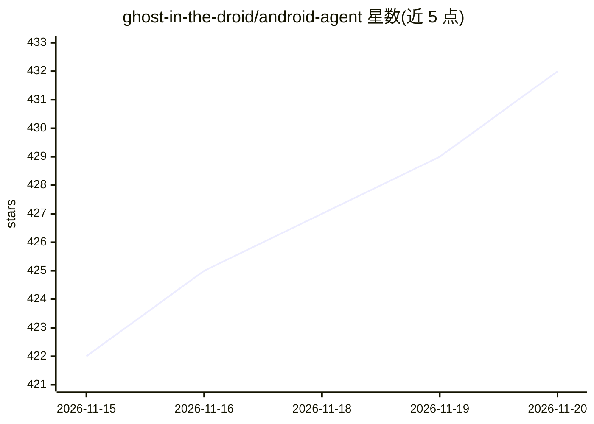

# ghost-in-the-droid/android-agent

⭐ 432 · Python · MIT · 推送 2026-11-15 · [GitHub](https://github.com/ghost-in-the-droid/android-agent) · [官网](https://ghostinthedroid.com) · 组织维护

**给 AI agent 提供真实手机操控身体的移动设备自动化框架**

开源 Python 框架，让任意 LLM agent 操控真实 Android（ADB）或 iPhone（Appium/WebDriverAgent）：读取屏幕、点击、滑动、输入，提供 66 个 MCP 工具与 117 个技能的社区 Skill Hub。平台、模型（Claude Code/Anthropic/OpenRouter/Ollama/vLLM/端侧 llama.cpp 等）与驱动方式（MCP 客户端、LangChain、CLI、Web 面板、REST API）均可替换组合。已知流程可编译为零 LLM 调用的确定性技能。iOS 支持需 Mac/Xcode 并为 opt-in；默认零 App 安装、无需 root。

## 筛选速览

| 维度 | 判定 | 备注 |
|---|---|---|
| AI 角色 | `ai-ecosystem` | LLM/agent 周边工具 |
| 许可风险 | `permissive` | MIT |
| 部署形态 | `library` | 以包/库形式分发 |
| 模型依赖 | local-ok | 支持本地模型 |
| 硬件要求 | — | 无带数字的原话,不猜 |
| 安装摩擦 | `low` | 无编译、无系统依赖或容器化 |
| 成熟度 | — | 结构信号不足 |

## 能力要点

- 66 个 MCP 工具控制 Android（ADB）与 iOS（WebDriverAgent）真机
- 平台/模型/驱动三者均可替换组合，支持云端与端侧模型
- YAML+Python 技能系统，已知工作流零 LLM 调用回放
- Skill Hub 社区技能注册表（117 技能/113 应用）与多设备手机农场

## 适用场景

- 让 Claude Code、Codex 等 MCP 客户端操控真实手机完成任务
- 为常用 App 定义可复用技能，避免每次调用 LLM
- 多设备手机农场上排队执行自动化与集成测试

## 场景标签

`Agent 框架` `GUI 自动化` · 领域:Agent 开发

## 证据(README 行号)

> L31: **Ghost is the body.** It gives any LLM agent a real Android phone or iPhone: it reads the screen, taps, swipes, an
> L76: Open-source Python framework for controlling Android and iOS devices from one agent harness. Android runs through A
> L221: ## Give any AI agent a mobile body (MCP)

## 星数曲线

2026-11-15 422 → 2026-11-20 432（+10）

---
*卡片 v1 · prompt 1.4 · 生成 2026-11-17 · 置信度 mid · 依据 README sha `6acae6917258` · [字段定义](../../DATASET.md)*
