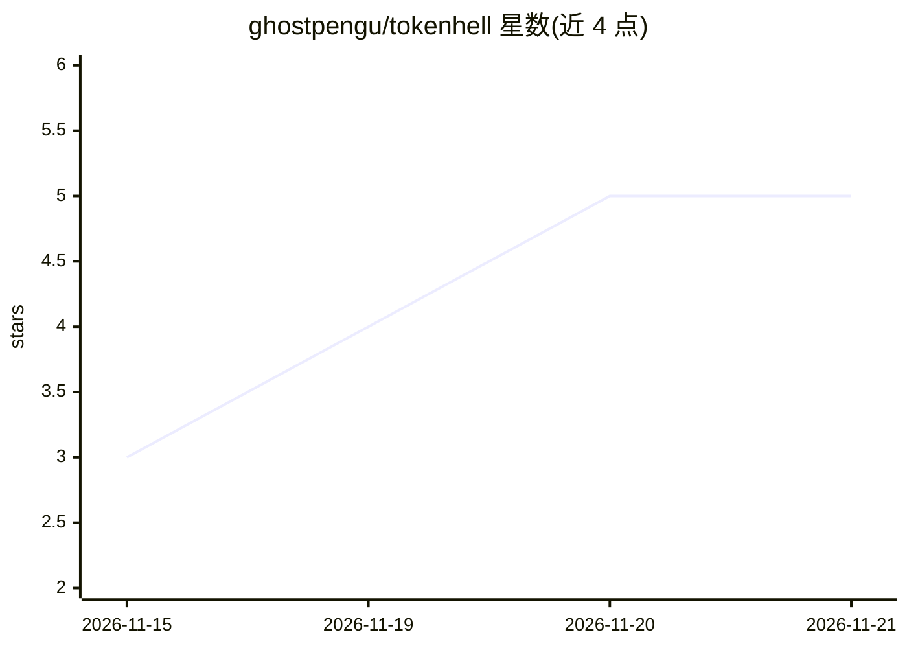

# ghostpengu/tokenhell

⭐ 5 · Rust · MIT · 推送 2026-11-16 · [GitHub](https://github.com/ghostpengu/tokenhell) · [官网](https://ghostpengu.github.io/tokenhell/) · 个人维护

**在 macOS 菜单栏聚合各 AI 编码工具的 token 用量与计划额度**

一款 Rust + Tauri + Svelte 5 的 macOS 菜单栏应用（macOS 14+，14.3 MiB universal 包），读取 Claude Code、Codex、Cursor、Grok、Copilot、Gemini CLI 等 11 个 AI 编码工具的本地日志文件与官方用量端点，汇总今日/7天/30天 token 消耗、按请求计价的 API 等价成本，并轮询各家的 5h/周/月计划限额与重置倒计时。本地 SQLite 存储，仅存数字与时间戳，不存提示词与响应，无服务器无遥测。Claude/Cursor 实时限额需经 macOS 钥匙串读取登录令牌。安装为 Releases 的 dmg，或自行用 pnpm+Tauri 构建。

## 筛选速览

| 维度 | 判定 | 备注 |
|---|---|---|
| AI 角色 | `ai-ecosystem` | LLM/agent 周边工具 |
| 许可风险 | `permissive` | MIT |
| 部署形态 | `desktop` | 安装包/桌面程序 |
| 模型依赖 | — | README 未给出锁定关系 |
| 硬件要求 | — | 无带数字的原话,不猜 |
| 安装摩擦 | `low` | 无编译、无系统依赖或容器化 |
| 成熟度 | — | 结构信号不足 |

## 能力要点

- 读取 11 个 AI 编码工具的本地日志（JSONL/SQLite）汇总 token 用量
- 按请求逐条计价的 API 等价成本，含缓存 TTL、长上下文与优先级档位
- 实时计划限额监控与重置倒计时，额度将满时托盘图标填充
- 本地运行，无服务器/遥测，不存储提示词与响应

## 适用场景

- 同时订阅多个 AI 编码工具时统一查看 token 消耗
- 在菜单栏查看 Claude/Codex 等计划额度的剩余与重置时间
- 估算订阅用量折算成 API 计价的成本

## 场景标签

`LLM 可观测性` · 领域:评测与运维

## 证据(README 行号)

> L5: **See every token you burn, across every AI coding tool, right in your menu bar.**
> L22: - **⏳ Live plan limits:** Claude's 5h and weekly windows (including Opus-only), Codex 5h/week, Antigravity's per-fa
> L63: |**Claude Code**|`~/.claude/projects/**/*.jsonl` (deduped per request)|OAuth usage endpoint (token from Keychain)|

## 星数曲线

2026-11-15 3 → 2026-11-21 5（+2）

---
*卡片 v1 · prompt 1.4 · 生成 2026-11-21 · 置信度 mid · 依据 README sha `4e2eb93e9a91` · [字段定义](../../DATASET.md)*
