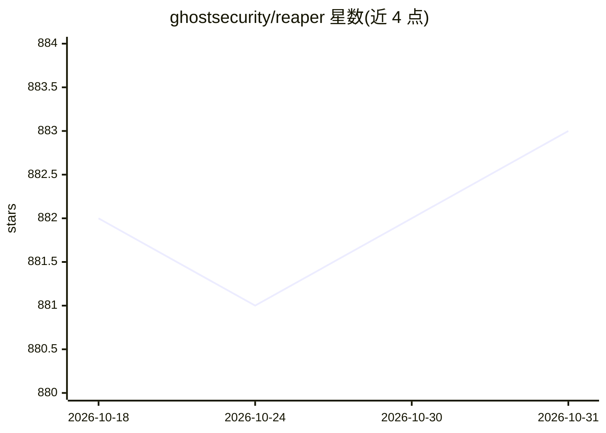

# ghostsecurity/reaper

⭐ 883 · Go · Apache-2.0 · 推送 2026-03-24 · [GitHub](https://github.com/ghostsecurity/reaper) · [官网](https://oss.ghostsecurity.ai/tools/reaper) · 组织维护

**面向应用安全测试的 MITM HTTPS 代理，记录流量并支持 AI agent 使用**

Ghost Security Reaper 是一个用于应用安全测试的中间人（MITM）HTTPS 代理：拦截指定范围内的流量，将请求与响应记录到本地数据库，并提供 CLI 用于搜索和检视捕获的流量。定位为同时便于人类与 AI agent 使用的测试工具，并提及配套的 Ghost Security Skills 供 agent 集成。支持 Linux 与 macOS，通过 install.sh 脚本安装或直接从 GitHub Releases 下载；文档与教程发布于 ghostsecurity.ai。仓库采用 Apache 2.0 许可。

## 筛选速览

| 维度 | 判定 | 备注 |
|---|---|---|
| AI 角色 | `ai-enhanced` | 去掉 AI 部分产品仍成立 |
| 许可风险 | `permissive` | Apache-2.0 |
| 部署形态 | `None` |  |
| 模型依赖 | — | README 未给出锁定关系 |
| 硬件要求 | — | 无带数字的原话,不猜 |
| 安装摩擦 | `low` | 无编译、无系统依赖或容器化 |
| 成熟度 | — | 结构信号不足 |

## 能力要点

- MITM HTTPS 代理，拦截并记录范围内流量到本地数据库
- 提供 CLI 搜索与检视捕获的请求/响应
- 声明可供人类与 AI agent 使用，agent 集成见 Ghost Security Skills

## 适用场景

- 测试 Web 应用时捕获并检视 HTTPS 流量
- 让 AI agent 通过 CLI 检索分析捕获的流量用于安全测试

## 场景标签

`网络安全` · 领域:学习与行业

## 证据(README 行号)

> L5: MITM HTTPS proxy for application security testing. Intercepts in-scope traffic, logs requests and responses to a loc

## 星数曲线

2026-10-18 882 → 2026-10-31 883（+1）

---
*卡片 v1 · prompt 1.4 · 生成 2026-10-21 · 置信度 mid · 依据 README sha `074288a60bc5` · [字段定义](../../DATASET.md)*
