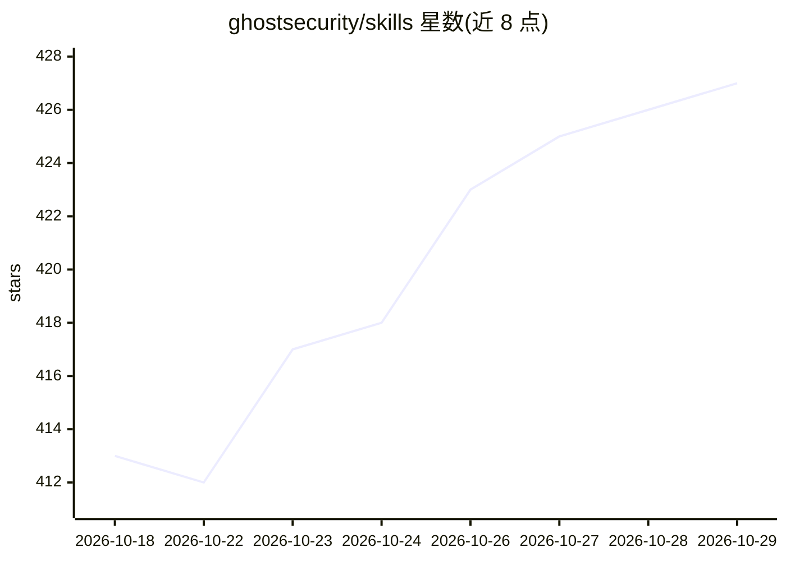

# ghostsecurity/skills

⭐ 427 · Python · Apache-2.0 · 推送 2026-09-28 · [GitHub](https://github.com/ghostsecurity/skills) · [官网](https://ghostsecurity.ai) · 组织维护

**面向 Claude Code 的应用安全插件市场：安全扫描工具+AI 技能层**

Ghost Security 为 Claude Code 发布的插件市场，包含两个插件：AppSec Skills（ghost）与 Exo（exo）。AppSec Skills 由四个独立工具（Poltergeist 密钥扫描、Wraith 依赖扫描、Reaper MITM 代理验证、Exorcist 代码分析）组成，上层由 AI 技能层编排成 find–validate–fix 安全流水线；工具以 Go 二进制经 GitHub releases 分发，技能为 Claude Code 中运行的提示文件，规则与判定标准为可定制的 YAML。工具可脱离技能单独使用，结果留在本地。

## 筛选速览

| 维度 | 判定 | 备注 |
|---|---|---|
| AI 角色 | `ai-ecosystem` | LLM/agent 周边工具 |
| 许可风险 | `permissive` | Apache-2.0 |
| 部署形态 | `None` |  |
| 模型依赖 | — | README 未给出锁定关系 |
| 硬件要求 | — | 无带数字的原话,不猜 |
| 安装摩擦 | `low` | 无编译、无系统依赖或容器化 |
| 成熟度 | — | 结构信号不足 |

## 能力要点

- 四个确定性安全工具（密钥/依赖/代码扫描、动态验证）+ AI 技能层编排
- 七项技能覆盖仓库上下文、SCA、SAST、DAST 与综合报告
- find–validate–fix 三阶段循环，输出含修复建议
- 工具与规则可独立使用和扩展，结果本地缓存

## 适用场景

- 让 Claude Code 内的编码 agent 在开发流程中做安全扫描与修复
- 对仓库做密钥、依赖与代码漏洞的综合审计
- 在真实应用上动态验证扫描发现项

## 场景标签

`网络安全` · 领域:学习与行业

## 证据(README 行号)

> L3: This repository is the Ghost Security plugin marketplace for Claude Code. It ships two plugins: Ghost Security AppSe
> L32: Ghost Security AppSec Skills are an agent-native application security plugin for Claude Code. They give your AI cod

## 星数曲线

2026-10-18 413 → 2026-10-29 427（+14）

---
*卡片 v1 · prompt 1.4 · 生成 2026-10-21 · 置信度 high · 依据 README sha `0f95738706bf` · [字段定义](../../DATASET.md)*
