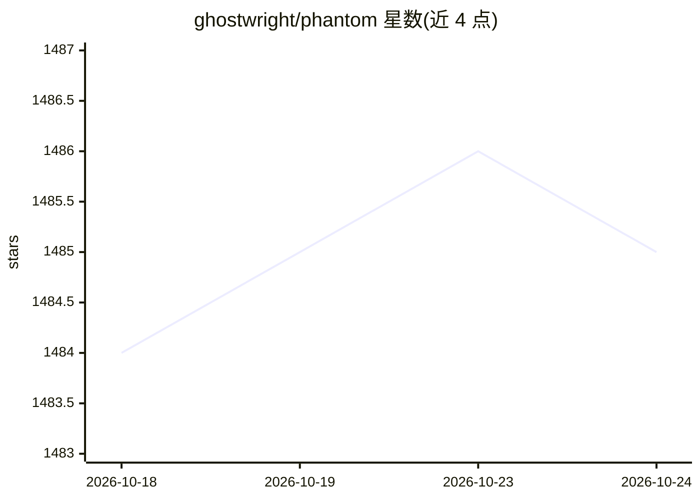

# ghostwright/phantom

⭐ 1,484 · TypeScript · Apache-2.0 · 推送 2026-06-16 · [GitHub](https://github.com/ghostwright/phantom) · [官网](https://ghostwright.dev/phantom) · 组织维护

**给个人和团队的自主 AI 同事：运行在专属虚拟机上，长期记忆并可自建工具**

基于 Claude Agent SDK 构建的自主 AI agent 系统：为 agent 分配专属计算机（VM/容器），可自行安装软件、启动数据库、构建仪表盘与 API，通过 Slack/Telegram/邮件/Web 对话交互，具备持久记忆（Qdrant 向量库）、运行时自建 MCP 工具与自进化机制。支持 Anthropic、Ollama、vLLM 等 7 种模型后端，YAML 两行切换。以 Docker Compose 部署为主，官方另提供免费托管 VM；README 明确提示 Docker socket 挂载带来 root 级安全风险，建议运行在专用机器上。

## 筛选速览

| 维度 | 判定 | 备注 |
|---|---|---|
| AI 角色 | `ai-native` | 本体是模型或模型工具 |
| 许可风险 | `permissive` | Apache-2.0 |
| 部署形态 | `self-host` | docker 或自建部署 |
| 模型依赖 | local-ok | 支持本地模型 |
| 硬件要求 | — | 无带数字的原话,不猜 |
| 安装摩擦 | `low` | 无编译、无系统依赖或容器化 |
| 成熟度 | — | 结构信号不足 |

## 能力要点

- agent 拥有专属计算机，自行安装软件、启动数据库并部署带公网 URL 的服务
- 持久记忆（Qdrant）+ 运行时自建并注册 MCP 工具
- 7 种模型后端开箱支持（Anthropic/Z.AI/OpenRouter/Ollama/vLLM/LiteLLM/自定义），YAML 两行切换
- 凭据 AES-256-GCM 加密、安全表单收集，Slack/Telegram/邮件/Webhook 多通道

## 适用场景

- 在 Slack 里让 AI 同事搭建仪表盘、数据管道和自动化报告
- 让 agent 在隔离 VM 上管理基础设施，不占用本机资源
- 非程序员用自然语言构建落地页、表单、Chrome 扩展并获取分享链接
- 软件团队用其做代码库导读、站会摘要与自定义 MCP 工具

## 场景标签

`Agent 框架` `Agent 记忆` `AI 助手` · 领域:Agent 开发

## 证据(README 行号)

> L20: Phantom takes a different approach: **give the AI its own computer.** A dedicated machine where it installs softwar
> L22: This is not a chatbot. It is a co-worker that runs on Slack, has a web chat interface at `/chat`, has its own email
> L64: Phantom is not locked to any single AI backend. It ships with support for seven providers out of the box, configure

## 星数曲线

2026-10-18 1,484 → 2026-10-24 1,485（+1）

---
*卡片 v1 · prompt 1.4 · 生成 2026-10-21 · 置信度 high · 依据 README sha `68c43db96274` · [字段定义](../../DATASET.md)*
