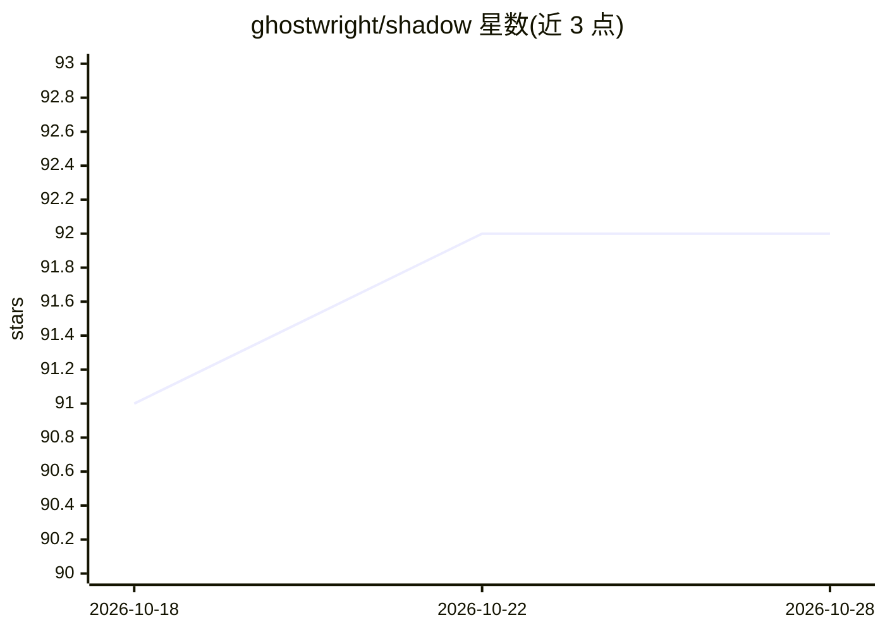

# ghostwright/shadow

⭐ 93 · Swift · MIT · 推送 2026-03-16 · [GitHub](https://github.com/ghostwright/shadow) · [官网](https://ghostwright.dev/shadow) · 组织维护

**macOS 本地个人智能引擎：全量记录电脑行为并主动提供 AI 辅助**

面向 macOS 用户的全本机个人智能应用：持续采集屏幕、音频、键鼠、无障碍树、剪贴板、git、终端等 14 类信号，按时间戳同步存储于本地；在此之上运行 episode 生成、双层心跳式主动观察推送、CLIP+全文混合搜索、会议转录摘要，以及带安全门控的 26 工具 computer-use agent（含 Mimicry 流程回放）。LLM（Qwen 7B/32B）经 MLX 完全运行于 Apple Silicon，Whisper 做本地转写，可选接入云端 LLM（自带 API key）。限制：仅支持 macOS 14+ 与 Apple Silicon，Qwen 32B 需 48GB+ 内存；需从源码构建。

## 筛选速览

| 维度 | 判定 | 备注 |
|---|---|---|
| AI 角色 | `ai-native` | 本体是模型或模型工具 |
| 许可风险 | `permissive` | MIT |
| 部署形态 | `None` |  |
| 模型依赖 | — | README 未给出锁定关系 |
| 硬件要求 | — | 无带数字的原话,不猜 |
| 安装摩擦 | `low` | 无编译、无系统依赖或容器化 |
| 成熟度 | — | 结构信号不足 |

## 能力要点

- 14 模态采集：屏幕、音频、键鼠、无障碍树、剪贴板、git、终端等按时间戳同步
- 双层本地 LLM（7B/32B，MLX，Apple Silicon）+ KV-cache 会话复用
- 26 工具 agent 运行时与安全门控的流程回放（预检、后验证、撤销）
- 数据 100% 本地，无账户/遥测/云依赖；平均 CPU 低于 3%，每日 200-600MB
- 产出 (state, action, next_state) 格式的 computer-use 训练数据

## 适用场景

- 回查自己某时刻的工作上下文（截图、转录、搜索记录）
- 让 AI 观察我的操作流程并代为回放执行重复任务
- 获得主动式提醒与工作模式分析（提交未完成、会议后续等）
- 采集真实人类电脑操作轨迹用于行为克隆训练数据

## 场景标签

`GUI 自动化` `语音识别` `AI 助手` `Agent 记忆` · 领域:Agent 开发

## 证据(README 行号)

> L12: Shadow is a personal intelligence engine for macOS. It captures every signal your computer produces while you work,
> L14: This is not a screen recorder. Shadow generates episodes from your work, runs a continuous heartbeat that pushes pr
> L47: |On-device LLM|Qwen 7B/32B via MLX|No|No|No|Cloud API|

## 星数曲线

2026-10-18 91 → 2026-10-28 92（+1）

---
*卡片 v1 · prompt 1.4 · 生成 2026-10-23 · 置信度 high · 依据 README sha `642365f483c1` · [字段定义](../../DATASET.md)*
