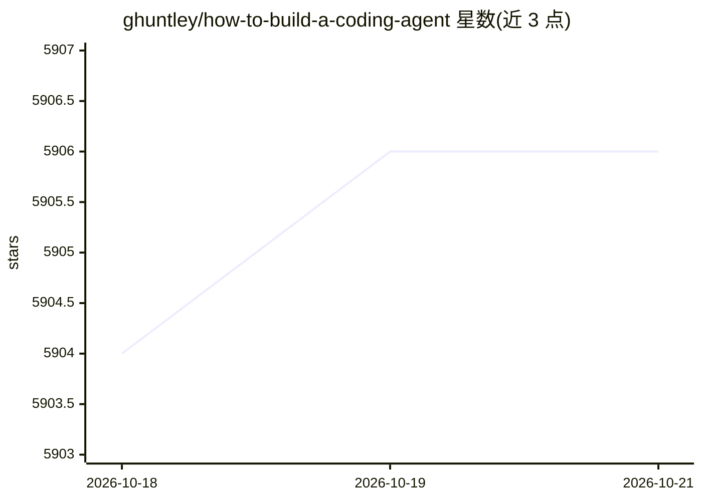

# ghuntley/how-to-build-a-coding-agent

⭐ 5,906 · Go · 推送 2026-10-17 · [GitHub](https://github.com/ghuntley/how-to-build-a-coding-agent) · [官网](https://ghuntley.com/agent/) · 个人维护

**教学工坊：用 Go 分步搭建自己的 AI 编程助手**

面向不要求 AI 背景的开发者的动手教程：以 Go 1.24.2+ 与 Anthropic API key 为前置，从基础聊天开始，逐版本构建 6 个递进的编程助手（chat/read/list_files/bash/edit/code_search），讲解事件循环、工具定义、schema 生成与错误处理机制；代码搜索步骤使用 ripgrep。提供 devenv 一键环境加载与手动 go mod tidy 两种配置方式，每步用 go run 运行对应单文件。

## 筛选速览

| 维度 | 判定 | 备注 |
|---|---|---|
| AI 角色 | `ai-knowledge` | 知识聚合/清单类 |
| 许可风险 | `none` | — |
| 部署形态 | `None` |  |
| 模型依赖 | locked-api |  |
| 硬件要求 | — | 无带数字的原话,不猜 |
| 安装摩擦 | `low` | 无编译、无系统依赖或容器化 |
| 成熟度 | — | 结构信号不足 |

## 能力要点

- 6 个递进版本：基础聊天→文件读取→目录浏览→Shell 执行→文件编辑→代码搜索
- 讲解 agent 事件循环与工具定义机制（名称/输入 schema/函数）
- 基于 Go struct 自动生成工具 schema
- devenv 与手动 go mod tidy 两种环境配置途径

## 适用场景

- 我想学习 coding agent 的内部工作原理并亲手实现一个
- 我想练习用 Go 接入 Anthropic API 并构建工具调用
- 我想理解 Cursor/Cline 类产品的底层 agent 架构

## 场景标签

`教程课程` · 领域:学习与行业

## 证据(README 行号)

> L1: # 🧠 Build Your Own Coding Agent via a Step-by-Step Workshop
> L21: You’ll build 6 versions of a coding assistant.
> L61: ## 🚀 Getting Started

## 星数曲线

2026-10-18 5,904 → 2026-10-21 5,906（+2）

---
*卡片 v1 · prompt 1.4 · 生成 2026-10-20 · 置信度 high · 依据 README sha `8b6a4b46a73b` · [字段定义](../../DATASET.md)*
