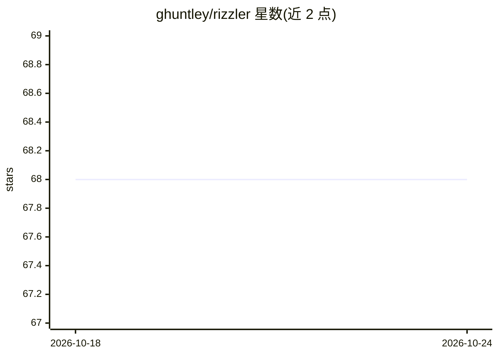

# ghuntley/rizzler

⭐ 68 · Rust · MIT · 推送 2026-04-23 · [GitHub](https://github.com/ghuntley/rizzler) · [官网](https://ghuntley.com/) · 个人维护

**给开发者的 CLI：用 LLM 自动解决 Git 合并冲突**

Rust 编写的 Git merge driver：注册为 Git 自定义合并驱动后，在 merge/pull/rebase 遇到冲突时自动调用 LLM（OpenAI、Anthropic、Gemini、AWS Bedrock）生成合并结果，另有 whitespace-only 规则策略与 ai-fallback 多供应商顺序重试。通过环境变量、git config、.rizzler TOML 文件分层配置，支持按文件扩展名指定策略与多级回退。README 明确警告 AI 不理解代码语义，建议勿直接用于生产主分支。

## 筛选速览

| 维度 | 判定 | 备注 |
|---|---|---|
| AI 角色 | `ai-native` | 本体是模型或模型工具 |
| 许可风险 | `permissive` | MIT |
| 部署形态 | `desktop` | 安装包/桌面程序 |
| 模型依赖 | locked-api |  |
| 硬件要求 | — | 无带数字的原话,不猜 |
| 安装摩擦 | `medium` | 含编译或系统依赖之一 |
| 成熟度 | — | 结构信号不足 |

## 能力要点

- 注册为 Git merge driver，按 .gitattributes 匹配的文件自动解决冲突
- 支持 OpenAI/Anthropic/Gemini/Bedrock 四类 AI 供应商，OpenAI 可自定义 base URL
- whitespace-only 规则策略与 ai-fallback 多供应商顺序重试
- 按文件扩展名细粒度配置解决策略，配置分环境变量/git config/TOML 三层

## 适用场景

- rebase 功能分支时自动解决低风险合并冲突
- 为指定类型文件配置 AI 合并驱动，减少手动解冲突
- 希望合并时多个 AI 供应商按序兜底

## 场景标签

`代码生成` · 领域:编码与开发

## 证据(README 行号)

> L7: 🚀 **Enter rizzler:** Your new AI bestie that actually *gets* Git. This ain't your grandpa's merge tool. rizzler slid
> L147: * **`ai` (Default & The Brainiac):** This is the main event. It sends the conflicting code snippets (plus maybe so

## 星数曲线

2026-10-18 68 → 2026-10-24 68（+0）

---
*卡片 v1 · prompt 1.4 · 生成 2026-10-24 · 置信度 high · 依据 README sha `d512a275accd` · [字段定义](../../DATASET.md)*
