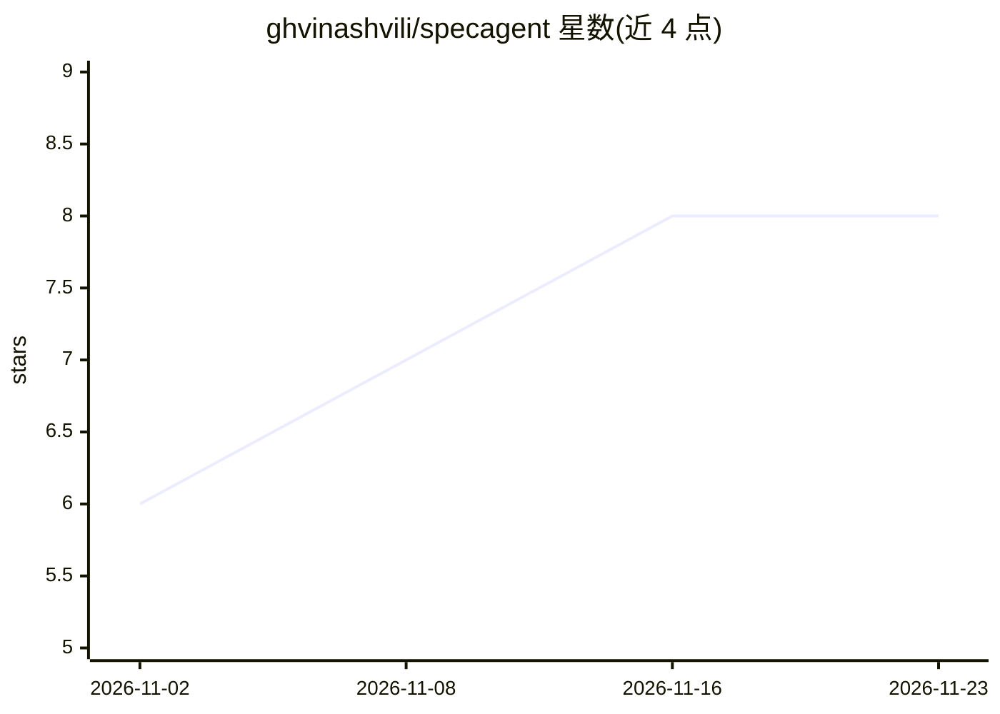

# ghvinashvili/specagent

⭐ 8 · Python · Apache-2.0 · 推送 2026-11-04 · [GitHub](https://github.com/ghvinashvili/specagent) · 个人维护

**给多包软件工程的多 Claude Code 会话流水线项目模板**

一个项目模板（非插件），围绕 Claude Code 构建多角色会话流水线：用户与一个 manager chat 交互，由它把 spec-writer、planner、critic、builder、verifier、judge 等角色作为完整会话（非 subagent）依次启动，各会话有独立 worktree、sandbox 与 brief。阶段推进由代码中的 gate 控制，finding 须附证明，每会话只做一个工作单元，按角色统计用量与成本，每个用户有私有 vault。支持 Linux、macOS、Windows (WSL2)。

## 筛选速览

| 维度 | 判定 | 备注 |
|---|---|---|
| AI 角色 | `ai-ecosystem` | LLM/agent 周边工具 |
| 许可风险 | `permissive` | Apache-2.0 |
| 部署形态 | `None` |  |
| 模型依赖 | — | README 未给出锁定关系 |
| 硬件要求 | — | 无带数字的原话,不猜 |
| 安装摩擦 | `low` | 无编译、无系统依赖或容器化 |
| 成熟度 | — | 结构信号不足 |

## 能力要点

- 每个角色作为完整 Claude Code 会话运行，由 manager chat 管理与启动
- 代码化 gate 与 finding 证明要求，最多三轮后按规则裁决
- usage_report.py 按角色统计会话数、调用、平均上下文与成本
- 私有 vault 与页面进公共 commons 前的代码化检查（commons 仓库尚未建成）

## 适用场景

- 用多会话流水线管理跨多包的大型代码改动
- 为 Claude Code 工作流引入代码化阶段门与证据要求
- 按角色测量和记录 AI 开发流程的成本与用量

## 场景标签

`多智能体` `编码 Agent` · 领域:Agent 开发

## 证据(README 行号)

> L9: **SpecAgent Pro Template: a project template, not a plugin. Special agents for hard software, every role a full sess
> L11: every role as a full Claude Code session, never a subagent. A stage moves on only through a gate in code, a finding
> L24: - **Every role is a full session, run by a manager chat,** with every demand a subagent would get for the same job

## 星数曲线

2026-11-02 6 → 2026-11-23 8（+2）

---
*卡片 v1 · prompt 1.4 · 生成 2026-11-20 · 置信度 high · 依据 README sha `af5cb79d188b` · [字段定义](../../DATASET.md)*
