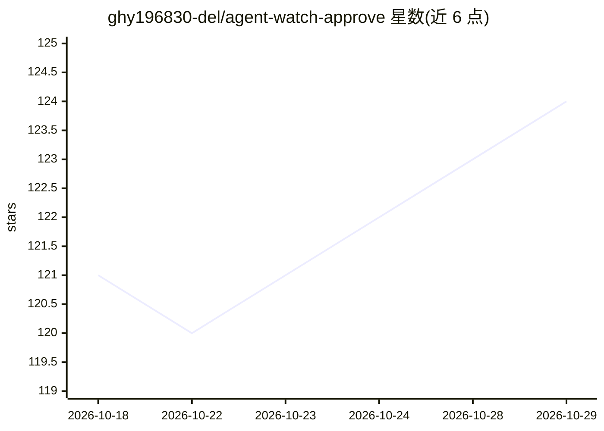

# ghy196830-del/agent-watch-approve

⭐ 124 · Python · MIT · 推送 2026-06-16 · [GitHub](https://github.com/ghy196830-del/agent-watch-approve) · 个人维护 · 中文 README

**在 Apple Watch/手机上远程审批 Claude Code/Codex 危险操作并接收完成提醒**

由两个 Python 脚本构成的 hook 工具：拦截 Claude Code（PreToolUse/Stop/StopFailure）与 Codex CLI（PermissionRequest/Stop）事件，把危险命令、多选决策题、任务完成与额度预警经 Pushcut（苹果）或 ntfy（安卓/Wear OS/鸿蒙兼容模式）推送到手表/手机，按钮点选结果回传 agent。只用标准库零依赖，配置缺失或网络故障时退回 agent 终端审批。支持危险清单正则、自动驾驶模式、脚本自身目录防篡改与多窗口独立回执 topic。

## 筛选速览

| 维度 | 判定 | 备注 |
|---|---|---|
| AI 角色 | `ai-ecosystem` | LLM/agent 周边工具 |
| 许可风险 | `permissive` | MIT |
| 部署形态 | `library` | 以包/库形式分发 |
| 模型依赖 | locked-api |  |
| 硬件要求 | — | 无带数字的原话,不猜 |
| 安装摩擦 | `low` | 无编译、无系统依赖或容器化 |
| 成熟度 | — | 结构信号不足 |

## 能力要点

- 危险操作与多选题推送到手表审批，结果回传 agent
- 任务完成、额度用尽/预警（Codex ≥90%）、API 异常通知
- 零依赖纯标准库，全程 fail-safe 退回终端审批
- Pushcut 苹果链路与 ntfy 安卓链路双载体支持

## 适用场景

- 长任务跑批时离开终端，在手表上批准 rm -rf、git push --force 等危险命令
- 同时开多个 Claude Code/Codex 窗口，按项目名区分审批来源
- 订阅额度烧完或快烧完时第一时间收到手表提醒
- 无 GMS 安卓机用 ntfy（F-Droid 版）实现同等审批链路

## 场景标签

 · 领域:开发者工具/AI Agent 运维

## 证据(README 行号)

> L5: 让 **Claude Code** 和 **Codex** 的危险操作推送到你的 **Apple Watch / iPhone** 上审批,
> L62: 1. **⌚ 远程审批** —— 危险操作(`rm -rf`、`git push --force`、提权、出沙箱……)推送到手表,带 **✅ 允许 / ❌ 拒绝 / 🖥️ 终端查看** 按钮,点一下,结果秒回 agent(「终端查
> L114: 关键就两块:`PreToolUse`(审批)+ `Stop`(完成提醒),matcher 用 `"*"` 配合 danger-only(见下文「自动驾驶」)。

## 星数曲线

2026-10-18 121 → 2026-10-29 124（+3）

---
*卡片 v1 · prompt 1.4 · 生成 2026-10-23 · 置信度 mid · 依据 README sha `4c518e7c27df` · [字段定义](../../DATASET.md)*
