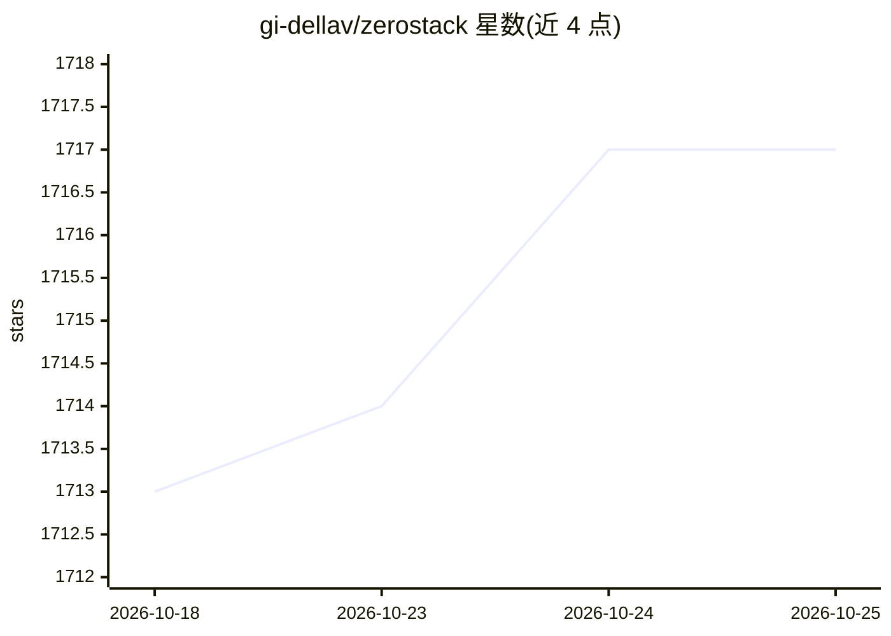

# gi-dellav/zerostack

⭐ 1,720 · Rust · GPL-3.0 · 推送 2026-10-23 · [GitHub](https://github.com/gi-dellav/zerostack) · [官网](https://gi-dellav.github.io/zerostack/) · 个人维护

**Rust 编写的轻量编程 agent，面向终端使用**

用 Rust 实现的命令行编程 agent，受 pi 与 opencode 启发。提供多模型接入（OpenRouter/OpenAI/Anthropic/Gemini/Ollama 及自定义 provider）、标准编码工具、五级权限模式、会话保存与自动压缩、crossterm 终端 UI、14 种内置系统提示（code/plan/review/debug 等）与提示链、MCP 支持、子代理、持久 Markdown 记忆、生命周期钩子、ACP 协议与可选沙箱（bubblewrap/zerobox）。自称二进制 26MB、平均内存约 16MB。安装途径含脚本、cargo、Homebrew 与 Nix；Windows 未测试。

## 筛选速览

| 维度 | 判定 | 备注 |
|---|---|---|
| AI 角色 | `ai-native` | 本体是模型或模型工具 |
| 许可风险 | `viral` | GPL-3.0 |
| 部署形态 | `library` | 以包/库形式分发 |
| 模型依赖 | local-ok | 支持本地模型 |
| 硬件要求 | — | 无带数字的原话,不猜 |
| 安装摩擦 | `low` | 无编译、无系统依赖或容器化 |
| 成熟度 | — | 结构信号不足 |

## 能力要点

- 多 provider 接入：OpenRouter、OpenAI、Anthropic、Gemini、Ollama 及自定义
- 14 种内置系统提示模式与 brainstorm→plan→code→review 提示链
- 五级权限模式 + 会话允许列表 + doom-loop 检测
- 持久 Markdown 记忆、MCP、ACP、生命周期钩子、可选 bubblewrap/zerobox 沙箱

## 适用场景

- 在终端用自然语言让 AI 读写代码、执行命令与调试
- 以低内存占用长时间运行编程 agent
- 通过权限模式与沙箱控制 agent 的文件与网络访问

## 场景标签

`编码 Agent` · 领域:编码与开发

## 证据(README 行号)

> L4: Minimal coding agent written in Rust, inspired by pi and opencode.
> L12: - **Multi-provider**: OpenRouter, OpenAI, Anthropic, Gemini, Ollama, plus custom providers

## 星数曲线

2026-10-18 1,713 → 2026-10-25 1,717（+4）

---
*卡片 v1 · prompt 1.4 · 生成 2026-10-21 · 置信度 high · 依据 README sha `43ab224ba577` · [字段定义](../../DATASET.md)*
