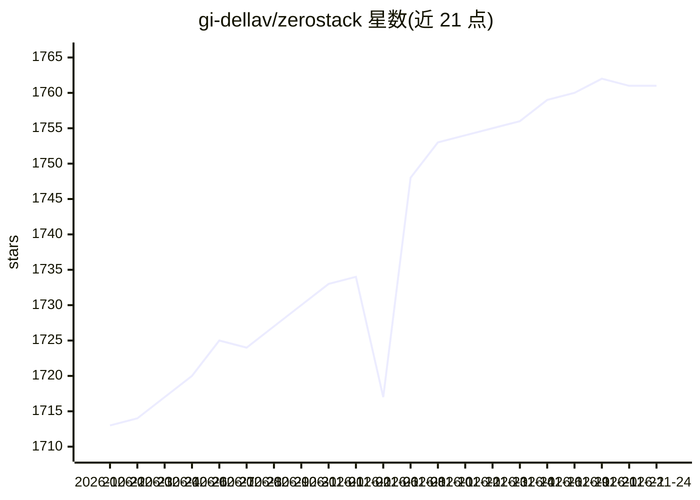

# gi-dellav/zerostack

⭐ 1,761 · Rust · GPL-3.0 · 推送 2026-11-18 · [GitHub](https://github.com/gi-dellav/zerostack) · [官网](https://gi-dellav.github.io/zerostack/) · 个人维护

**面向开发者的 Rust 轻量终端编码 Agent，注重内存与性能**

以 Rust 编写的终端编码 Agent，提供多模型提供方接入（OpenRouter 为默认）、标准编码工具集、五级权限系统、会话保存/恢复与自动压缩、MCP 服务器接入、子代理并行探索、持久化 Markdown 记忆及十余种可切换的系统提示模式。安装提供脚本、Cargo、Homebrew、Nix 等方式，可选 bubblewrap/zerobox 沙箱隔离 bash 命令。README 未包含 Windows 实测说明，沙箱为可选组件。

## 筛选速览

| 维度 | 判定 | 备注 |
|---|---|---|
| AI 角色 | `ai-ecosystem` | LLM/agent 周边工具 |
| 许可风险 | `viral` | GPL-3.0 |
| 部署形态 | `library` | 以包/库形式分发 |
| 模型依赖 | local-ok | 支持本地模型 |
| 硬件要求 | — | 无带数字的原话,不猜 |
| 安装摩擦 | `low` | 无编译、无系统依赖或容器化 |
| 成熟度 | — | 结构信号不足 |

## 能力要点

- 多提供方支持：OpenRouter、OpenAI、Anthropic、Gemini、Ollama 及自定义提供方
- 五级权限模式、按工具 glob 规则与会话允许列表、Doom-loop 检测
- 15 种内置提示模式（code/plan/review/debug 等）与提示链式推进
- 可选沙箱模式：bubblewrap/zerobox 后端，凭证目录掩蔽与网络隔离选项

## 适用场景

- 在终端用命令行 Agent 完成代码编写、审查与重构任务
- 以低内存占用环境运行编码 Agent
- 通过权限规则与沙箱控制 Agent 可执行的命令范围

## 场景标签

`编码 Agent` · 领域:编码与开发

## 证据(README 行号)

> L4: Minimal coding agent written in Rust, inspired by pi and opencode.
> L12: - **Multi-provider**: OpenRouter, OpenAI, Anthropic, Gemini, Ollama, plus custom providers

## 星数曲线

2026-10-22 1,713 → 2026-11-24 1,761（+48）

---
*卡片 v1 · prompt 1.4 · 生成 2026-11-23 · 置信度 high · 依据 README sha `98aa27db1c2a` · [字段定义](../../DATASET.md)*
